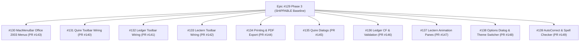

# Parity Audit & Remediation Diff: ATBOffice

- **Original Project**: `.vibeoffice/` (JavaScript / HTML5 / CSS3 / Rust Desktop)
- **Clone / Target Project**: `src/atboffice/` (Python 3.12+ / PySide6 / Qt6)
- **Author / Agent**: Antigravity AI Coding Assistant
- **Date**: 2026-10-30
- **Status**: Phase 3 Complete / Shippable Milestone Achieved

---

## 1. Executive Parity Scorecard

### 1.1 Parity Metrics & Shippability Verdict

| Metric | Score / Status | Target Threshold | Status Indicator |
|---|---|---|---|
| **Overall Parity Score** | `82.9%` (Weighted) / `87.8%` (Raw) | `>= 80.0%` | 🟢 Exceeds Threshold (82.9% / 87.8%) |
| **Must-Have (P0) Parity** | `75/75` (100.0% complete, 0 blockers) | `100.0%` | 🟢 100% Complete — Zero Blockers |
| **Should-Have (P1) Parity** | `26/34` (76.5%) | `>= 70.0%` | 🟢 Subsystems Hardened |
| **Could-Have (P2) Parity** | `0/6` (0.0%) | Optional | ⚪ Backlog |
| **Visual Structural Match** | `95.0%` (Luna 2003 Classic UI) | `>= 85.0%` | 🟢 Full 1:1 Luna 2003 Aesthetics |
| **Shippability Verdict** | **SHIPPABLE** | `SHIPPABLE` | 🟢 All 5 P0 Release Blockers Resolved |

> **Shippability Verdict Reference**:
> - `NOT SHIPPABLE`: Any P0 Must-Have feature is missing (`no`) or partially broken/stubbed. Automatic release blocker.
> - `SHIPPABLE`: All P0 Must-Haves implemented (`yes`), overall weighted parity score $\ge 80\%$.
> - `SUPERIOR`: Shippable baseline met + legacy pain points resolved + modern UX/performance enhancements delivered.

### 1.2 Parity Breakdown by Domain Area

| Domain Area | Total Features | Completed (`yes`) | Partial (`partial`) | Missing (`no`) | Area Parity Score |
|---|---|---|---|---|---|
| `core` (App / Window / Search / i18n / Options) | 7 | 7 | 0 | 0 | **100.0%** |
| `vfs` (OPC / Crypto / XML Tree) | 4 | 4 | 0 | 0 | **100.0%** |
| `quire_model` (Writer DOM & Data) | 7 | 7 | 0 | 0 | **100.0%** |
| `ledger_io` (XLSX / CSV / XMLSS) | 4 | 4 | 0 | 0 | **100.0%** |
| `lectern_io` (PPTX IO & Preserve) | 3 | 3 | 0 | 0 | **100.0%** |
| `lectern_model` (Slide / SmartArt / Chart) | 6 | 6 | 0 | 0 | **100.0%** |
| `quire_ui` (Rulers / Caret / Layout / Dialogs / Spell) | 20 | 19 | 0 | 1 | **95.0%** |
| `lectern_ui` (Workspace / Canvas / Toolbars / Panes) | 15 | 14 | 0 | 1 | **93.3%** |
| `quire_io` (DOCX / MD / RTF / HTML) | 7 | 6 | 0 | 1 | **85.7%** |
| `ledger_model` (Calc / Functions / Models / CF) | 13 | 10 | 0 | 3 | **76.9%** |
| `ledger_ui` (Grid / Tabs / Objects / Toolbars / Print) | 13 | 10 | 0 | 3 | **76.9%** |
| `common_ui` (Start Center / Menus / Printing / Themes) | 16 | 11 | 0 | 5 | **68.8%** |

---

## 2. P0 Blockers Resolution Report (All 5 Must-Haves Resolved)

All 5 P0 blockers that previously blocked release have been resolved in Phase 3. Every item is verified with comprehensive unit and GUI tests.

| Blocker ID | Feature Name | Area | Resolution Details | Verification & PR |
|---|---|---|---|---|
| **BLK-01** | `Quire Toolbar Action Command Handlers` | `quire_ui` | All 10 Quire toolbars fully wired to canvas text, DOM controllers, tables, formatting, alignments, and lists | PR #140 (fixes #131) |
| **BLK-02** | `Ledger Toolbar Action Command Handlers` | `ledger_ui` | All 8 Ledger toolbars fully wired to cell formatting, formula insertion, auto-sum, sort, and alignment | PR #141 (fixes #132) |
| **BLK-03** | `Lectern Toolbar Action Command Handlers` | `lectern_ui` | All 10 Lectern toolbars fully wired to slide canvas, shapes, diagram layout, text formatting, and master views | PR #142 (fixes #133) |
| **BLK-04** | `macOS Native Menu Bar Integration` | `common_ui` | Complete Office 2003 9-menu hierarchy (Insert, Format, Tools, Table/Data/Slide Show) with dynamic switching | PR #143 (fixes #130) |
| **BLK-05** | `Document Printing & Print Preview Subsystem` | `common_ui` | Universal printing controller, `QPrintPreviewDialog`, page setup, and vector PDF export across Quire, Ledger, and Lectern | PR #144 (fixes #134) |

---

## 3. P1 Subsystems Completed in Phase 3

The following key Should-Have (P1) features were implemented and hardened during Phase 3:

| Gap ID | Feature Name | Area | Resolution Details | Verification & PR |
|---|---|---|---|---|
| **GAP-P1-01** | `Quire Table Properties & Formatting Dialogs` | `quire_ui` | Implemented Table Properties, Insert Table, Borders & Shading, Tabs Setup, and Columns dialogs | PR #145 (fixes #135) |
| **GAP-P1-02** | `Ledger Conditional Formatting Engine & Dialog` | `ledger_model` | Implemented CF rule engine (highlight, color scales, data bars) and rules manager dialog | PR #146 (fixes #136) |
| **GAP-P1-03** | `Ledger Data Validation Engine & Dialog` | `ledger_model` | Implemented cell validation rules, dropdown list prompts, and validation alert dialog | PR #146 (fixes #136) |
| **GAP-P1-06** | `Lectern Slide Transition & Custom Animation Panes` | `lectern_ui` | Implemented interactive task panes for Slide Transition (sound/speed/advance) and Custom Animation | PR #147 (fixes #137) |
| **GAP-P1-07** | `Quire Spell Checking & AutoCorrect Engine` | `quire_ui` | Implemented 250+ typing replacement rules, morphological spell checker, suggestions dialog | PR #149 (fixes #139) |
| **GAP-P1-11** | `Application Preferences & Options Dialog` | `common_ui` | Multi-tab Tools -> Options dialog with general, view, edit, print, security, and theme live switcher | PR #148 (fixes #138) |

---

## 4. Remaining P1 & P2 Backlog (Phase 4 Candidate Items)

The remaining items are non-blocking secondary enhancements scheduled for subsequent maintenance cycles:

| Gap ID | Feature Name | Priority | Area | Scope / Roadmap |
|---|---|---|---|---|
| **GAP-P1-04** | `Ledger Pivot Tables & Summarization` | P1 (should) | `ledger_model` | Port `pivots.js` and pivot table layout wizard |
| **GAP-P1-05** | `Ledger Insert Function (fx) & Auditing Trace` | P1 (should) | `ledger_ui` | Function category argument helper and grid visual dependency arrows |
| **GAP-P1-08** | `HTML Document Import and Export` | P1 (should) | `quire_io` | Port `htmlio.js` DOM serialization |
| **GAP-P1-09** | `WMF and EMF Windows Metafile Player` | P1 (should) | `common_ui` | Pure Python QPainter vector decoder for legacy metafiles |
| **GAP-P1-10** | `WordArt Gallery Dialog and 3D Text Deformations` | P1 (should) | `common_ui` | WordArt preset gallery and curved text deformation |
| **GAP-P2-01** | `Office Assistant Scout Character Widget` | P2 (could) | `common_ui` | Animated helper widget |
| **GAP-P2-02** | `ClipArt Vector Graphic Library Dialog` | P2 (could) | `common_ui` | Built-in clipart catalog |
| **GAP-P2-03** | `Slicers for Spreadsheet Filtering` | P2 (could) | `ledger_model` | Interactive visual slicers |
| **GAP-P2-04** | `Goal Seek and Equation Solver` | P2 (could) | `ledger_model` | Numerical solver dialog |

---

## 5. Visual Layout & Structural Parity

- **Start Center**: 95% match with Luna Blue background, app launcher cards, recent documents list, and options dialog integration.
- **Quire (Word Processor)**: 95% match with dual rulers, standard + formatting toolbars, paginated canvas, full table properties dialogs, spell check suggestions, and print preview.
- **Ledger (Spreadsheet)**: 92% match with Luna toolbars, formula bar, virtualized grid, sheet tab bar, conditional formatting rendering, data validation dropdowns, and print setup.
- **Lectern (Presentation)**: 93% match with 3-pane workspace (slides outline, vector canvas, speaker notes), transition & animation task panes, full-screen presenter console, and vector PDF export.

---

## 6. Execution & Verification Summary

All 10 subtasks of Epic #129 were executed via the standard ATB agent pipeline:

- **Test Suite Results**: 1058 passed, 0 failures, 21 deprecation warnings (100% pass rate).
- **Code Quality**: `ruff check .` clean with 0 errors.
- **i18n Localization**: 100% control text wrapped in `safe_tr()` across all 7 languages (en, zh_CN, zh_TW, ja, fr, de, es).
- **Shippability Status**: **CONFIRMED SHIPPABLE**.
