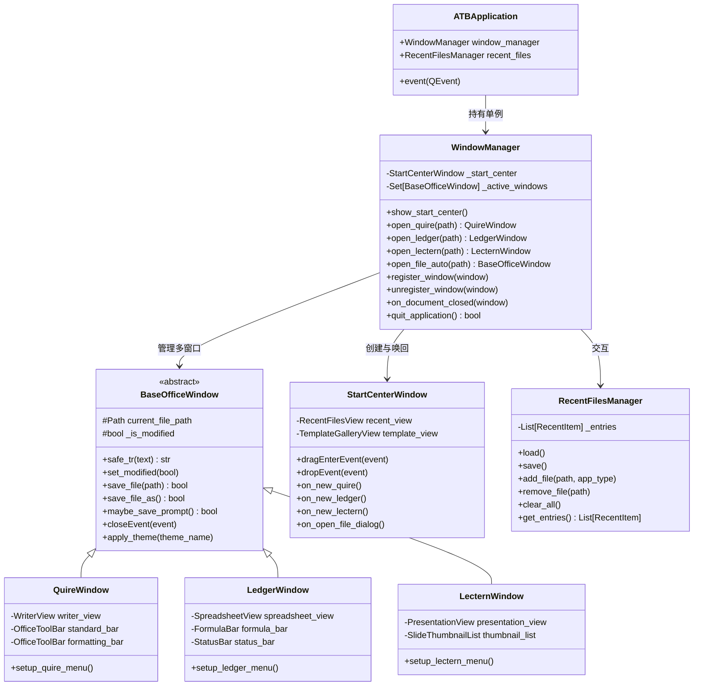

# ATBOffice 启动中心与专属窗口入口架构设计规范 (Design Spec)

- **日期**：2026-10-28
- **模块**：应用入口、启动中心 (Start Center)、专用主窗口 (Quire/Ledger/Lectern) 与窗口管理器 (WindowManager)
- **状态**：待评审 (Ready for Review)

---

## 1. 背景与目标 (Context & Objectives)

### 1.1 背景
当前 ATBOffice 的底层三大组件（**Quire** 文字处理、**Ledger** 电子表格、**Lectern** 演示文稿）核心组件与视图层已基本移植完成。然而当前应用入口为单一的 `MainWindow`，仅通过一个 `QTabWidget` 粗暴地将三大模块容纳在同一窗口的三个标签页中。这种方式存在以下问题：
1. 缺少专属应用的菜单栏与工具栏深度定制；
2. 无法在桌面环境下独立并排打开多个文档窗口；
3. 缺少统一的启动欢迎面板（Start Center），不利于文档历史管理与模板快速新建；
4. 无法通过命令行灵活拉起特定应用或针对关联文件进行智能分派。

### 1.2 目标
1. **统一启动中心 (Start Center)**：提供类似 LibreOffice / VibeOffice 的启动中心，包含三大模块快速新建入口、最近文档卡片列表、模板入口以及全局文件拖拽识别。
2. **专属独立窗口派生**：拆分出 `QuireWindow`、`LedgerWindow`、`LecternWindow`，均继承自通用的 `BaseOfficeWindow`，具备原生的 macOS 菜单与 Luna 2003 皮肤。
3. **窗口生命周期管理 (WindowManager)**：实现多窗口生命周期的自动化协调，支持在文档窗口全关闭时自动唤回 Start Center，并在退出时执行全局未保存检查。
4. **灵活多样的 CLI 调度**：支持 `atboffice` 无参启动、子命令启动（`atboffice quire [file]`）以及基于文件扩展名自动嗅探分发。

---

## 2. 总体架构与类职责设计 (Architecture & Classes)



### 2.1 模块职责详解

1. **`WindowManager` (`src/atboffice/core/window_manager.py`)**：
   - 维护唯一的 `StartCenterWindow` 实例与活跃文档窗口集合 `_active_windows: set[BaseOfficeWindow]`。
   - 实现启动中心与文档窗口的互斥/协同显示：打开文档窗口时将 Start Center 置入后台或隐藏；当最后一个文档窗口关闭时自动调用 `show_start_center()` 并激活置顶。
   - 统一处理应用退出逻辑（`quit_application`），依次询问各脏窗口，确保用户未保存内容安全。

2. **`BaseOfficeWindow` (`src/atboffice/ui/shell/base_window.py`)**：
   - 继承自 `QMainWindow`，封装通用能力：
     - 文档脏标记：`set_modified(bool)`，设置 macOS 窗口关闭红点中的小黑点（`setWindowModified(bool)`）；
     - 关闭拦截：重写 `closeEvent`，调用 `maybe_save_prompt()` 询问“保存”、“不保存”、“取消”；
     - 主题切换：支持 Office 2003 Luna Blue/Silver/Olive 与 Classic 风格；
     - 窗口销毁时自动通知 `WindowManager.unregister_window(self)`。

3. **专属文档窗口类**：
   - **`QuireWindow` (`src/atboffice/ui/shell/quire_window.py`)**：
     - 宿主 `WriterView`；
     - 专属于文字排版的菜单体系（Word 2003 风格：文件、编辑、视图、插入、格式、工具、表格、窗口、帮助）；
     - 标准工具栏、排版工具栏、交互标尺与审阅面板。
   - **`LedgerWindow` (`src/atboffice/ui/shell/ledger_window.py`)**：
     - 宿主 `SpreadsheetView`；
     - 专属于电子表格的菜单体系（Excel 2003 风格：增加数据 Data 菜单）；
     - 公式栏（FormulaBar）、工作表标签栏（SheetTabWidget）、AutoCalculate 计算状态栏。
   - **`LecternWindow` (`src/atboffice/ui/shell/lectern_window.py`)**：
     - 宿主 `PresentationView`；
     - 专属于幻灯片演示的菜单体系（增加放映 Slide Show 菜单）；
     - 幻灯片大纲/缩略图侧边栏与放映模式。

4. **`StartCenterWindow` (`src/atboffice/ui/shell/start_center.py`)**：
   - 启动中心顶层窗口，具备 1000×640 推荐尺寸；
   - 左侧侧边栏导航 + 右侧堆叠页面（最近文档 / 模板画廊）；
   - 支持全窗口文件拖放响应。

5. **`RecentFilesManager` (`src/atboffice/core/recent_files.py`)**：
   - 统一管理最近打开过的文档元数据，持久化到 `~/.atboffice/recent_files.json`；
   - 支持容量上限（默认 20 条，超额 FIFO 淘汰）；
   - 支持物理文件存在性检测，对已删除文件提供失效视觉标记和一键剔除。

---

## 3. 详细交互与流转机制 (Interactions & Lifecycle)

### 3.1 启动流转逻辑
1. **无参启动**：`python -m atboffice` $\rightarrow$ 初始化 `WindowManager` $\rightarrow$ 展现 `StartCenterWindow`。
2. **指定文件启动**：`python -m atboffice document.docx` $\rightarrow$ `WindowManager.open_file_auto("document.docx")`：
   - 依据文件后缀分派至 `QuireWindow`；
   - 记录该文件至 `RecentFilesManager`；
   - 直接显示 `QuireWindow`，Start Center 保持隐藏。
3. **指定子命令启动**：`python -m atboffice ledger [file]` $\rightarrow$ 直接初始化 `LedgerWindow` 并打开对应文件。

### 3.2 启动中心内部交互
- **新建按钮**：点击 Quire / Ledger / Lectern 卡片，直接创建并呈现一个未命名的专属文档窗口，同时 Start Center 自动隐藏。
- **最近文件点击**：从卡片点击某条记录，若文件物理存在则打开对应窗口并置顶；若文件已被移动或删除，弹窗友好提示：“找不到指定文件，是否从列表中移除？”
- **全屏文件拖放 (Drag & Drop)**：
  - `dragEnterEvent`：检测 MIME 数据包含本地文件路径，展示高亮边框和释放提示；
  - `dropEvent`：提取文件路径，调用 `WindowManager.open_file_auto(path)` 立即打开。

### 3.3 文档关闭与唤回机制
- **单个文档窗口关闭**：
  1. 触发 `BaseOfficeWindow.closeEvent`；
  2. 若文档已修改，弹出标准提示：`保存` / `不保存` / `取消`；
  3. 取消则终止关闭流程；若确认关闭，调用 `WindowManager.unregister_window(self)`；
  4. `WindowManager` 检查剩余活跃文档窗口数量：
     - 若 `len(_active_windows) == 0`，自动执行 `_start_center.show()`、`_start_center.raise_()` 并 `_start_center.activateWindow()`，重新唤回启动中心；
     - 若仍有其他文档窗口处于打开状态，则保持当前桌面状态。
- **全局退出 (`Cmd+Q` / Exit 菜单)**：
  1. `WindowManager.quit_application()` 遍历所有脏窗口；
  2. 遇到未保存修改依次请求用户确认；若用户在任一窗口点击“取消”，整体退出流程立即中断，保留现场；
  3. 全部落盘或放弃后，释放全部窗口并调用 `QApplication.quit()`。

---

## 4. CLI 路由与参数映射 (CLI & Entry Points)

在 `src/atboffice/__main__.py` 中构建轻量命令行路由器：

| 命令语法 | 目标行为 |
|---|---|
| `atboffice` | 打开启动中心 (`StartCenterWindow`) |
| `atboffice quire [file]` | 启动 Quire 文字处理窗口（可附带打开文档） |
| `atboffice ledger [file]` | 启动 Ledger 电子表格窗口（可附带打开文档） |
| `atboffice lectern [file]` | 启动 Lectern 演示文稿窗口（可附带打开文档） |
| `atboffice <file>` | 根据后缀名自动识别应用并启动对应窗口 |
| `atboffice -v, --version` | 输出 ATBOffice 版本号 |
| `atboffice -h, --help` | 显示使用指南与帮助 |

在 `pyproject.toml` 中配置便捷脚本命令：
```toml
[project.scripts]
atboffice = "atboffice.__main__:main"
atboffice-quire = "atboffice.__main__:main_quire"
atboffice-ledger = "atboffice.__main__:main_ledger"
atboffice-lectern = "atboffice.__main__:main_lectern"
```

---

## 5. 国际化与鲁棒性防错 (i18n & Robustness)

1. **i18n 全覆盖**：
   - 所有 UI 文本（按钮、标题、卡片说明、对话框、提示信息）100% 使用 `safe_tr()` / `tr()` 包裹；
   - 所有窗体和自定义部件实现 `retranslate_ui()`。
2. **前瞻性防御 ("Think One Step Ahead")**：
   - **空路径与异常文件**：对不存在文件、不可读权限、0 字节损坏文件进行异常保护，提示用户并阻止崩溃；
   - **非办公格式拖拽**：用户拖入不支持的格式（如 `.zip`, `.png`）时友好提示，不抛出未经处理的异常；
   - **多文档并发与重入防范**：在新建或打开文档时增加加载锁/状态标记，避免连续猛击导致重复加载多开。

---

## 6. 测试与验证方案 (Testing Plan)

在 `tests/` 目录下新增以下测试文件：
1. **`tests/test_recent_files.py`**：
   - 测试最近文件的写入、读取、去重、置顶、上限 20 条淘汰；
   - 测试文件丢失时的状态标记与删除操作。
2. **`tests/test_cli_router.py`**：
   - 测试不同命令行参数分发到不同窗口打开函数；
   - 测试常见扩展名（`.docx`, `.xlsx`, `.pptx`, `.csv`）的自动匹配规则。
3. **`tests/test_window_manager.py`**：
   - 测试窗口注册与注销；
   - 测试最后一个文档窗口关闭后自动唤回 Start Center；
   - 测试未保存文档在退出时的拦截行为。
4. **`tests/test_start_center_ui.py`**：
   - 验证 Start Center 控件布局与信号连接；
   - 验证全屏文件拖放事件模拟。
