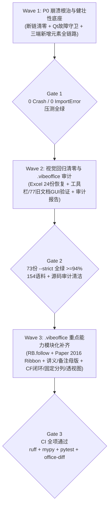

# ATBOffice 第十二期健壮性加固与 `.vibeoffice` 全量对齐设计规格（Phase 12 Design Spec）

> **日期**：2026-11-26  
> **代码基线**：`v0.2.0`（`ecac6b3`）  
> **对照基线**：`.vibeoffice/`（原版 JS/HTML 黄金参考实现）  
> **实施架构**：Plan A — 三波次门禁分层架构（Wave 1 崩溃止血与健壮性底座 → Wave 2 视觉回归清零与全量对比审计 → Wave 3 `.vibeoffice` 重点能力模块化补齐）  
> **触发问题**：通过 `python -m atboffice` 启动后，打开 `.docx`、`.xlsx`、`.pptx` 文档并执行新增元素等编辑动作时存在崩溃或界面卡死；同时需要对照 `.vibeoffice` 及测试文档渲染重新体检剩余差异。

---

## 一、 `v0.2.0` 基线实测问题清单

在 `v0.2.0`（`ecac6b3`）上执行静态导入审计、三编辑器新增元素交互探针、`source_diff.py --check`、`audit_toolbars_parity.py`、`run_corpus_audit.py --strict` 以及 73 份核心文档视觉比对（`run_office_diff.py --all --capture --strict`），已定位以下确凿问题：

### 1.1 运行期崩溃与断链（P0）

1. **4 处生产代码懒加载 `ImportError`（触发即抛出未捕获异常）**：
   - `src/atboffice/ui/shell/ledger_auditing.py:120` 与 `:192`：从 `atboffice.modules.spreadsheet.calc.references` 导入不存在的 `to_a1`（应使用 `cell_name`）。
   - `src/atboffice/modules/writer/view.py:312`：审阅工具栏 `_on_new_comment` 从 `atboffice.modules.writer.models.revision` 导入不存在的 `add_comment`（应统一经由可撤销的 `self.canvas_view.insert_comment` 执行）。
   - `src/atboffice/modules/spreadsheet/calc/fn_dynamic.py:797`：`INDIRECT` 函数从 `atboffice.modules.spreadsheet.calc.references` 导入不存在的 `parse_cell_reference`（应使用 `parse_range`）。
2. **Quire 新增自选图形与后续编辑交互阻断**：
   - `QuireWindow.insert_shape`（`src/atboffice/ui/shell/quire_window.py:1813`）通过 `hasattr(canvas, "insert_shape")` 调用画布方法，但 `WriterCanvasView` 及其拆分 mixin（`canvas_view.py` / `canvas_editing.py` / `canvas_input.py`）均未定义 `insert_shape`，导致插入自选图形静默无效果。
   - 在真实 `.docx`（`openxml-sdk__bullet-complex.docx`）上执行「插入图形/文本框 → 点击画布 → 键入文本」交互探针时发生事件/焦点卡死。
3. **Qt C++ 对象生命周期与异步回调缺少统一防护**：
   - `src/atboffice/ui/shell/lectern_history.py:96` 使用无主对象存活校验的 `QTimer.singleShot(0, self.flush)`，在窗口关闭或演讲稿切换后仍可能触发回调；
   - `~/Library/Logs/DiagnosticReports/Python-2026-11-25-*.ips` 记录了 `QToolBar::clear()` → `QWidget::removeAction()` → `QToolBar::actionEvent()` → `QMetaObject::cast()` 的 `SIGSEGV` / `SIGBUS` 原生崩溃信号，反映 Qt widget/action 销毁时序与事件重入风险仍需在窗口关闭及异步回调入口做集中防护；
   - 高频画布/对象层/场景事件回调（`paintEvent`、`mouse*Event`、`keyPressEvent`、`focusOutEvent`）缺少统一的异常隔离与 `shiboken6.isValid()` 守卫。

### 1.2 文档渲染视觉比对（`atb-office-diff`）回归

对 `v0.2.0` 运行 `scripts/run_office_diff.py --all --capture --strict` 实测结果（73 份核心 OOXML 文档）：

| 指标 | Phase 11 签核值 | `v0.2.0` 实测值 | 门禁要求 | 变化与归因 |
|---|---:|---:|---|---|
| **可比对文档数** | `73 / 73` | `73 / 73` | `73` | 尺寸与区域均对齐 |
| **前景加权平均相似度** | `93.79%` | **`92.71%`** | `>= 90.0%` | 下降 `1.08%` |
| **Pixel MAE 均值** | `96.53%` | `96.52%` | 参考指标 | 基本持平 |
| **单文档低于 85% 数** | `3`（之后 `#464` 修复） | **`3`** | `0`（豁免项除外） | `--strict` **失败** |
| **PowerPoint (25)** | 22 PARITY / 1 COSMETIC / 2 DRIFT | **24 PARITY / 1 COSMETIC** | `>= 85%` | `b4iso.pptx` 升至 `97.6%` |
| **Word (24)** | 全员 >= 85.4% | **全员 >= 85.4%** | `>= 85%` | 保持稳定 |
| **Excel (24)** | 多数 94%–98% | **全线掉分 5%–10%** | `>= 85%` | 详见下述根因 |

- **Excel 全线掉分根因**：Phase 3（`9eb12b7`）切到 Fusion + Luna 调色板并在 `src/atboffice/modules/spreadsheet/view.py:100` 将水平滚动条最小高度强设为 `SheetTabBar` 高度（叠加 `src/atboffice/ui/styles/luna_2003.py` 滚动条样式），使 `workspace` 区域右侧滚动条与底部工作表标签栏像素与 `.vibeoffice` 产生系统性偏差（连空白表 `libreoffice__empty.xlsx` 也从 `95.1%` 跌至 `89.7%`）；`poi__45540_form_Header.xlsx`（`81.8%`）与 `poi__49156.xlsx`（`84.5%`）跌破 `85%` 单文档门禁。
- **门禁统计口径不一致**：`scripts/office_diff/reporter.py` 已在报告中豁免 `expectations.json` 标记为 `reference_limitation` 的 `openxml-sdk__00d63cdd-ee44-4e6a-99af-a7966ffbdda0.xlsx`（`78.4%`），但 `scripts/run_office_diff.py:332` 的 `--strict` 失败计数尚未排除该豁免项。

### 1.3 语料、控件与 `.vibeoffice` 功能差距现状

- **语料审计**：`scripts/run_corpus_audit.py --strict`（154 份：77 有效 OOXML + 23 旧版导入 + 1 加密 + 3 损坏 + 50 不支持）全部通过，0 崩溃/0 超时/0 数据丢失；仍需补齐真实窗口 GUI 路径对 77 份旧格式与损坏文件的报错弹窗与状态回滚测试。
- **静态控件扫描**：`scripts/source_diff.py --check` 报 0 个 `ORPHAN_NO_SIGNAL`、0 个 `STUB_IMPLEMENTATION`；`scripts/audit_toolbars_parity.py` 发现工具栏文案存在跨模块错配（例如 Quire 审阅工具栏 `insertComment` 显示了 Excel 的 `"为活动单元格添加批注"`）。
- **`.vibeoffice` 重点差距复核**：
  - 通过代码核验确认 Ledger 的条件格式（`ColorScaleRule`、`DataBarRule`、`IconSetRule`）已在 `conditional_format_dialog.py`、`xlsx_reader.py`、`xlsx_writer.py` 中具备基础实现，Wave 3 重点核验并补闭其编辑回显、Undo/Redo 与渲染往返链路；
  - 其余 4 项核心差距尚未落地：**上下文任务窗格自动跟随（`RB.follow`）**、**Paper 2016 Ribbon 模式**（`ThemeDialog` 已有卡片但映射为经典样式）、**Lectern 讲义母版与备注母版**、**Ledger 分列固定宽度模式与数据透视图（PivotChart）**。

---

## 二、 总体架构与三波次门禁依赖（DAG）

采用三波次串行放行架构，每一波次必须通过独立验收门禁后才合入主干并进入下一波次，避免新特性引入回归掩盖崩溃归因：

---

## 三、 Wave 1 — P0 崩溃根治与健壮性底座

### 3.1 静态与懒加载导入完整性修复与门禁
- **直接修复 4 处断链**：
  - `src/atboffice/ui/shell/ledger_auditing.py:120, 192`：将 `from ...references import to_a1` 替换为 `cell_name`；
  - `src/atboffice/modules/writer/view.py:312`：将 `_on_new_comment` 改为调用 `self.canvas_view.insert_comment()`，纳入 `UndoService` 并同步刷新审阅窗格；
  - `src/atboffice/modules/spreadsheet/calc/fn_dynamic.py:797`：将 `parse_cell_reference` 替换为 `parse_range`。
- **新增回归测试** `tests/test_lazy_imports_integrity.py`：使用 AST 遍历 `src/atboffice/` 下全部顶层与函数内部 `from atboffice... import ...` 语句，逐一解析模块与符号，杜绝重构拆文件遗留的运行时 `ImportError`。

### 3.2 统一 Qt 故障隔离与 C++ 对象生命周期守卫（`src/atboffice/core/fault_guard.py`）
设计轻量的集中守卫模块，不吞掉异常、不破坏现有逻辑：
- **`is_alive(obj)`**：封装 `obj is not None and shiboken6.isValid(obj)`，并在窗口类场景追加检查 `not getattr(win, "_is_closed", False)`。
- **`safe_single_shot(delay_ms, owner, callback)`**：使用 `QTimer` 挂载于 `owner`（或绑定 `owner.destroyed` 信号自动 `stop()`），触发前校验 `is_alive(owner)`，防止窗口/场景销毁后的延迟回调导致 C++ Use-After-Free。
- **`guard_qt_slot(component, action_name, default=None)` & `guard_qt_event(component, event_name, default=False)`**：
  - 在 `paintEvent`、`mousePressEvent`、`mouseMoveEvent`、`mouseReleaseEvent`、`keyPressEvent`、`focusOutEvent` 与高频异步槽函数入口执行存活校验；
  - 若发生非预期 Python 异常：通过 `logger.exception` 记录完整堆栈、写入 `CrashDiagnostics`（附带 `ActionRecorder` 最近 50 步面包屑与活动文档 SHA），并在非绘制路径通过窗口状态栏/非阻塞提示可见告知用户，防止单步失败引发 Qt 事件循环死锁或进程直接闪退。
- **`BaseOfficeWindow.closeEvent` 清理契约**：在接受关闭后统一停止 `recovery_service` 定时器、通知编辑器视图停止悬停/光标闪烁/历史延迟刷新定时器（含 `PresentationHistory`），再交给主事件循环安全析构。

### 3.3 三编辑器「打开文档 → 新增元素 → 编辑 → 撤销 → 保存」全链路加固

1. **Quire（Word / `modules/writer/` + `ui/shell/quire_*.py`）**：
   - 在 `WriterCanvasView`（`canvas_editing.py`）补齐真实的 `insert_shape(shape_type: str)`：依据 `shape_type`（`rect` / `oval` / `line` / `arrow` / `textbox` / `basic` / `star` / `callout` 等）创建带 `FloatProperties` 的 `ShapeItem` 插入当前段落，纳入 `@_undoable("插入图形")` 并自动选中该浮动对象；
   - 打通 `QuireWindow` 中的 `reorder_selected_object`、`nudge_selected_object`、`align_selected_objects`、`rotate_selected_object` 到 `canvas_view` 的真实浮动对象操作（均通过 `UndoService` 记录）；
   - 排查并根治「插入图形/文本框后点击画布并键入文字」导致的焦点锁死/事件循环挂起（核查 `canvas_input.py` 鼠标释放状态复位、`CaretController` 选中浮动框与文本光标切换、以及文本框双击进入编辑或失焦退出的状态机）；
   - 加固表格/图片/图形/批注/艺术字/剪贴画在插入、排版、绘制与 DOCX 保存重开过程中的边界防护（空段落、空表格单元格、无效图片字节、超界索引）。
2. **Ledger（Excel / `modules/spreadsheet/` + `ui/shell/ledger_*.py`）**：
   - 修复批注插入/编辑（`ledger_auditing.py`）与 `INDIRECT`（`fn_dynamic.py`），并将批注增删改接入 `UndoService`；
   - 将 `SpreadsheetObjectLayer` 中新建/移动/缩放/删除图形、文本框、图片、图表纳入 `UndoService`，避免插入新对象后无法撤销或撤销后残留悬空对象选中态；
   - 加固 `SpreadsheetObjectLayer` 与 `GridViewport` 之间的焦点交接、拖拽句柄越界保护及空白单元格 `None` 判空；验证含新建浮动对象与批注的 `.xlsx` 保存重开无损。
3. **Lectern（PowerPoint / `modules/presentation/` + `ui/shell/lectern_*.py`）**：
   - 将 `PresentationHistory.note_edit` 的延迟提交改为 `safe_single_shot(0, self.window, self.flush)`，在 `closeEvent` / `reset()` 时取消挂起刷新；对 `snapshot_presentation` 的深拷贝路径增加异常上下文与 `_source_package` 只读共享保护；
   - 加固 `SlideScene` 鼠绘图形/文本框/连接线（`set_drawing_tool` + `mousePress/Move/Release`）、双击进入 `SlideTextEditor`、以及表格单元格文本编辑切换时的 `shiboken6.isValid()` 与提交顺序（先安全提交再重建图元）；
   - 核查 `insert_table` / `insert_image_bytes` / `insert_chart` / `insert_smartart` / `insert_wordart` / `insertComment` 后立即触发撤销、重做、重绘与 PPTX 保存重开。

### 3.4 Wave 1 验收门禁
- `tests/test_lazy_imports_integrity.py` 通过（0 缺失模块或符号）；
- 新增 `tests/gui/test_phase12_element_edit_robustness.py`：在 Quire / Ledger / Lectern 各自打开多份真实语料文档，依次执行全部新增元素操作 + 键鼠交互编辑 + 连续 Undo/Redo + 重绘 + 保存 + 重新打开 + 关闭窗口，要求 **0 崩溃、0 未捕获异常、0 卡死、`crash.log` 为空、重开文档元素完整**；
- 既有 `tests/gui/test_phase11_acceptance.py` 与 `tests/gui/test_undo_editors.py` 全绿。

---

## 四、 Wave 2 — 文档渲染回归清零与 `.vibeoffice` 全面对比审计

### 4.1 修复 `v0.2.0` Excel 24 份文档渲染回归
1. **滚动条与工作表标签栏像素对齐**：
   - 对比 `screenshots/office_audit_20261112/vibeoffice/excel/` 与 `v0.2.0` 的差异热力图，针对性调整 `src/atboffice/ui/styles/luna_2003.py`（Ledger 滚动条轨道/滑块尺寸与边框色）与 `src/atboffice/modules/spreadsheet/view.py` / `sheet_tab_bar.py`（滚动条高度与标签条边界），在保留 Luna 视觉的同时消除全表 chrome 像素偏差，使 `libreoffice__empty.xlsx` 回到 `>= 95%` 基线。
2. **修复低于 85% 的两份 Excel 文档**：
   - 检查 `poi__45540_form_Header.xlsx`（当前 `81.8%`）与 `poi__49156.xlsx`（当前 `84.5%`）的热力图，逐项校准文字字号度量、表头/单元格边距或网格线对齐，将两者稳定推升至 `>= 88%`。
3. **统一 `--strict` 豁免口径与双区域校验**：
   - 修改 `scripts/run_office_diff.py:332`，在 `failing` 判定中豁免 `expectations.json` 标记了 `reference_limitation` 的文档（与 `scripts/office_diff/reporter.py` 保持一致；此类文档仍计入全量均值并在报告第 5 节单列说明）；
   - 额外比对一次 `--region canvas`（纯画布无外围 chrome）作为辅助参考，确认工作区内容排版无任何退化。

### 4.2 `.vibeoffice` 三层全面对比审计与日常瑕疵清零
1. **控件、文案与命令层**：
   - 运行 `scripts/source_diff.py --check`、`scripts/audit_toolbars_parity.py` 及 `ActionRegistry` 全三端命令行探针；
   - 修复已发现及新扫出的工具栏/菜单文案与图标漂移（如 `src/atboffice/ui/shell/quire_toolbars.py` / `mac_menu.py` 中 Quire `insertComment` 提示错用 Ledger 文案的问题），更新 `docs/clone/TOOLBAR_BASELINE_MATRIX.md`。
2. **77 份旧版二进制与损坏语料 GUI 路径验证**：
   - 在 `tests/gui/test_phase12_corpus_gui_resilience.py` 中按三端真实窗口 `open_file` 抽检/覆盖 `.doc`/`.xls`/`.ppt`、加密与损坏语料，验证弹出清晰本地化提示/密码取消且**绝不破坏当前已打开文档与 dirty 状态**。
3. **生成第十二期审计交付文档**：
   - 更新 `docs/clone/OFFICE_DOCS_DIFF.md`（写入修复后 73 份最新实测结果）；
   - 编写第十二期总审计报告 `docs/clone/ATBOFFICE_PARITY_AND_STABILITY_AUDIT_2026_12.md`，完整记录稳定性、渲染、控件、语料与功能差距。

### 4.3 Wave 2 验收门禁
- `PYTHONPATH=src conda run -n ATBOffice python scripts/run_office_diff.py --all --capture --strict` 退出码 `0`：73/73 可比，前景加权均值 **`>= 94.0%`**，0 `CRITICAL_MISMATCH`，所有非豁免文档 **`>= 85.0%`**；
- `PYTHONPATH=src conda run -n ATBOffice python scripts/run_corpus_audit.py --strict` 154/154 全通过；
- `PYTHONPATH=src conda run -n ATBOffice python scripts/source_diff.py --check` 输出 `CLEAN`。

---

## 五、 Wave 3 — `.vibeoffice` 四项重点能力模块化设计

所有新增模块严格遵循 `AGENTS.md` 规范：可见文本走 `safe_tr()` + `retranslate_ui()`、命令走 `ActionRegistry`、文档变更走 `UndoService`、配色字体走 `ThemeTokens` + `ui_font()`、零 `PYTEST_CURRENT_TEST` 分支。

### 5.1 上下文任务窗格自动跟随（对标 `.vibeoffice` `RB.follow`）
- **新增模块**：`src/atboffice/ui/panes/context_tools_pane.py`，并在 `BaseOfficeWindow` 及三端窗口接入统一选择通知钩子。
- **配置开关**：在 `OptionsDialog`「视图」页增加 `"选中对象时任务窗格自动跟随"`（持久化键 `view/pane_follows_selection`，默认 `True`）。
- **状态机规则（严格对齐 `.vibeoffice/docs/suite.md`）**：
  - 仅在 `view/pane_follows_selection` 为真、右侧任务窗格**当前处于打开状态**且窗口宽度未进入窄屏遮挡模式时生效；绝不强行打开用户已关闭的任务窗格；
  - 首次进入上下文工具前记住原先窗格 ID（如剪贴板/开始工作/样式与格式）；取消选中或选回正文文本/单元格时自动恢复原先窗格；
  - 对象映射：
    - **Quire**：图片 → `图片工具`；自选图形/文本框/艺术字 → `绘图工具`；
    - **Ledger**：图表 → `图表工具`；图片 → `图片工具`；自选图形/文本框 → `绘图工具`；
    - **Lectern**：图片 → `图片工具`；自选图形/文本框 → `绘图工具`；表格 → `表格工具`；艺术字 → `艺术字工具`；SmartArt 保持既有文本大纲窗格。
  - 面板内按钮直接复用对应 `ActionRegistry` `QAction`，同步受 `enabled`/`checked` 状态驱动，不复制命令逻辑。

### 5.2 Paper 2016 Ribbon 模式（对标 `.vibeoffice/public/common/ribbon.js`）
- **模块拆分**：
  - 公共引擎 `src/atboffice/ui/components/ribbon_bar.py`：`RibbonBar`、`RibbonTabBar`、快速访问工具栏（QAT：`save`、`undo`、`redo`）、文件下拉菜单按钮、`RibbonGroup`（支持大图标/3 行中图标/2 行小图标组合、`make` 嵌入字体/字号/样式下拉、对话框启动器按钮、窄窗口自适应折叠成下拉组按钮）、着色上下文选项卡（仅选中对应对象时显示）、`Alt`/`F10` KeyTips 键盘提示层、以及 `Ctrl+F1`/双击标签折叠（按应用持久化 `ui/ribbon_collapsed_<app>`）。
  - 三端声明式规格：`src/atboffice/ui/shell/quire_ribbon.py`、`ledger_ribbon.py`、`lectern_ribbon.py`，纯数据描述选项卡、组、上下文组与补充图标映射。
- **延迟构建与主题切换隔离**：
  - 经典/Paper 主题（`blue`、`silver`、`olive`、`classic`、`paper`）启动时**完全不实例化 Ribbon**，零启动与内存开销，对默认 Office 2003 截图与 73 份视觉 Diff 零影响；
  - 仅当切换到 `paper2016` 主题时懒构建 `RibbonBar`、隐藏经典 `OfficeToolBar`（非 `paper2016` 时反向恢复经典工具栏可见态）。
- **契约测试**：新增 `tests/ui/test_ribbon_spec_parity.py`，校验三端 Ribbon 声明的每个命令 ID 均存在于对应窗口的 `ActionRegistry`、按钮具备图标、上下文选项卡随选中状态显隐、以及 `paper2016` ↔ `blue` 往返切换无异常与泄漏。

### 5.3 Lectern 讲义母版与备注母版（Handout Master / Notes Master）
- **扩展范围**：
  - 扩展 `src/atboffice/modules/presentation/views/master_view.py` 与 `LecternWindow` 视图命令（`view_handout_master`、`view_notes_master`），与现有 `view_slide_master` 共享母版工具条模式；
  - **讲义母版**：支持每页 1/2/3/4/6/9 张幻灯片版式预览切换，以及页眉、页脚、日期、页码占位框的显示开关与文本编辑；
  - **备注母版**：支持幻灯片缩略图占位框、备注正文区字体/边框样式及页眉页脚占位框编辑；
  - **模型、打印与 PPTX 往返**：将讲义/备注母版属性持久化到 `Presentation` 模型（及 `pptx_reader`/`pptx_writer` 保留/写回对应 master part），并让 Lectern 打印/打印预览（`handout` 与 `notes` 打印模式）直接读取母版页眉页脚与版式设置。

### 5.4 Ledger 条件格式闭环核验 + 固定宽度分列 & 数据透视图
- **既有条件格式闭环核验**：为已有的 2 色/3 色色阶、数据条、图标集补充完整测试（规则创建 → 对话框重新打开回显 → `UndoService` 撤销/重做 → `GridViewport` 绘制 → `.xlsx` 保存重开往返）。
- **固定宽度分列（Fixed Width Text-to-Columns）**：在 `src/atboffice/modules/spreadsheet/dialogs/text_to_columns_wizard.py` 实现第 2 步可点击/增删/拖拽分列标尺控件（以字符宽度对齐预览文本行），执行按位置切分列并将结果变更纳入 `UndoService`。
- **数据透视图（PivotChart）**：基于活动单元格所属 `PivotTable` 生成绑定透视摘要结果的柱形/折线/饼图 `FloatingObject`（纳入 `UndoService`），并在透视表数据刷新或字段布局变更时同步刷新关联透视图数据源与重绘。

### 5.5 Wave 3 验收门禁
- 全部新增 UI 支持中/英动态语言切换（`retranslate_ui()`）与 Luna/Paper/Paper 2016 主题切换；
- 全部 CI 与视觉/稳定性门禁一次性通过：
  - `ruff check .`
  - `ruff format --check .`
  - `mypy src/atboffice/core`
  - `QT_QPA_PLATFORM=offscreen pytest -n auto`
  - `PYTHONPATH=src conda run -n ATBOffice python scripts/run_office_diff.py --all --capture --strict`

---

## 六、 明确暂缓项（Phase 13 Backlog）

为保证第十二期聚焦与可交付性，以下 `.vibeoffice` 长尾能力明确记入后续 Phase 13 Backlog，不在本轮实施：
1. Ledger 规划求解（Solver）及 519 个公式函数的完整长尾对齐；
2. Quire 基于 WordNet `en.thes` 的离线同义词库信息检索窗格；
3. Quire 画布内交互式“绘制表格”画笔与擦除器鼠标工具。

---

## 七、 风险与缓解措施

| 风险 | 影响 | 缓解措施 |
|---|---|---|
| **PySide6 C++ 析构竞态难以在单一短测试复现** | 关闭窗口/切换视图/连续撤销时偶发 `SIGSEGV` | 通过 `fault_guard.py` 统一收敛 `shiboken6.isValid()` 与定时器清理，并在 `test_phase12_element_edit_robustness.py` 中对三端多轮重复开窗/插元素/关窗施压验证 |
| **Ledger 滚动条调整可能影响现有 UI 布局或主题观感** | 改善 Excel 视觉分数的同时引发标签被裁切 | 在 `test_phase12_ledger_chrome.py` 与真实窗口渲染中同时校验 `SheetTabBar` 可见高度与 73 份 `run_office_diff.py --strict` 分数 |
| **Paper 2016 Ribbon 影响默认 Office 2003 模式性能或视觉** | 启动变慢或污染经典模式截图 | 严格懒构建：仅当 `current_theme == "paper2016"` 时创建 `RibbonBar`，默认主题路径零实例化 |
| **Lectern 讲义/备注母版写入 PPTX 破坏未知 XML 部件** | 触发语料无损往返回归 | 仅在用户实际编辑母版且原包或模型存在对应部件时使用 `lxml` 原位修补，未修改部件原样透传并通过 `run_corpus_audit.py --strict` 门禁 |
