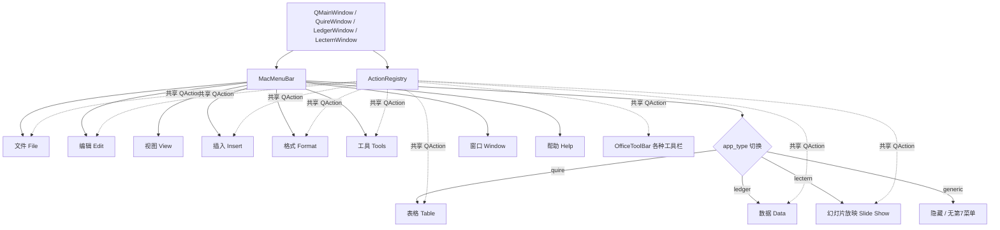

# Specification: Issue #130 — 扩展 MacMenuBar 补全 Office 2003 完整菜单体系 (插入/格式/工具/表格/数据/放映)

## 1. Overview & Problem Statement
当前 `src/atboffice/ui/shell/mac_menu.py` 仅硬编码了 5 个基础菜单（文件、编辑、视图、窗口、帮助），严重缺失 Office 经典的核心菜单体系：`插入 (Insert)`、`格式 (Format)`、`工具 (Tools)`，以及应用专有的 `表格 (Table - Quire)` / `数据 (Data - Ledger)` / `幻灯片放映 (Slide Show - Lectern)`。
同时，菜单项与各子系统工具栏动作此前存在动作实例分离的问题，无法自动同步启用/禁用、复选状态。

本规范定义并实现 Office 2003 经典的 9-菜单完整体系，利用 `ActionRegistry` 命令总线共享单一 `QAction` 实例，实现菜单项与工具栏动作状态的 100% 双向自动同步，并提供多语言动态翻译（`retranslate_ui`）与应用类型（`app_type`）热切换能力。

---

## 2. Requirements & Acceptance Criteria
1. **9-菜单经典体系完整布局**：
   - 核心通用菜单：
     - `文件 (File)`: 新建、打开、保存、另存为、打印、打印预览、关闭
     - `编辑 (Edit)`: 撤销、重做、剪切、复制、粘贴、全选、查找、替换、设置单元格格式 (Ledger)
     - `视图 (View)`: 全屏切换、放大、缩小、实际大小、主题子菜单 (Luna 2003 Blue / Silver)
     - `插入 (Insert)`: 分页符、页码、日期和时间、特殊符号、图片、自选图形、超链接
     - `格式 (Format)`: 字体、段落、项目符号和编号、边框底纹、制表位、样式和格式
     - `工具 (Tools)`: 拼写和语法检查、字数统计、语言、选项 (Options)
   - 应用专有第 7 菜单（根据 `app_type` 动态切换）：
     - `Quire`: `表格 (Table)`（绘制表格、插入表格、删除、选定、合并单元格、拆分单元格、表格属性）
     - `Ledger`: `数据 (Data)`（升序排序、降序排序、筛选、有效性、分类汇总、数据透视表）
     - `Lectern`: `幻灯片放映 (Slide Show)`（观看放映、从当前幻灯片放映、设置放映方式、录制旁白、排练计时、幻灯片切换）
     - `Generic`: 不展示第 7 菜单（总共 8 个菜单）
   - 窗口与帮助菜单：
     - `窗口 (Window)`: 最小化、缩放窗口、前置全部窗口
     - `帮助 (Help)`: ATBOffice 帮助、关于 ATBOffice
2. **ActionRegistry 集中共享与双向状态同步**：
   - `MacMenuBar` 优先接入父窗口的 `action_registry`（若无则内部初始化自足 `ActionRegistry`）。
   - 菜单项与工具栏共用相同的 `QAction` 实例。支持核心 action ID（如 `new`, `open`, `save`, `cut`, `copy`, `paste`, `bold`, `italic`, `underline`, `sortAsc`, `start_slideshow` 等）与经典菜单键别名（如 `file_new`, `edit_cut` 等）互通。
   - `set_enabled`、`set_checked`、快捷键、点击触发事件保持 100% 自动双向同步。
3. **100% 国际化与动态语言切换**：
   - 所有菜单标题与菜单项文本、状态栏提示、工具提示均通过 `safe_tr()` 国际化。
   - `retranslate_ui()` 在系统语言切换时即时重新翻译所有菜单及动作。
4. **测试验证**：
   - 新增 `tests/ui/test_mac_menu.py` 自动化测试集，覆盖 9 菜单结构、应用类型切换、ActionRegistry 双向状态同步、快捷键与国际化。
   - 保障既有测试（如 `tests/gui/test_mac_shell.py`）继续 100% 通过。

---

## 3. Architecture & Design

### 3.1 菜单层次与动态切换架构

### 3.2 动作 ID 对照表 (Core Action ID & Aliases)

| 菜单 | Action ID (Core) | Alias in menu_bar | 快捷键 / 特性 | 关联槽函数 / 模块 |
|---|---|---|---|---|
| **文件** | `new` | `file_new` | StandardKey.New | `new_file` |
| | `open` | `file_open` | StandardKey.Open | `open_file_dialog` |
| | `save` | `file_save` | StandardKey.Save | `save_file` |
| | `save_as` | `file_save_as` | StandardKey.SaveAs | `save_file_as` |
| | `print` | `file_print` | StandardKey.Print | `print_document` / `print` |
| | `printPreview` | `file_print_preview` | 无 | `print_preview` |
| | `close` | `file_close` | StandardKey.Close | `close` |
| **编辑** | `undo` | `edit_undo` | StandardKey.Undo | `undo` |
| | `redo` | `edit_redo` | StandardKey.Redo | `redo` |
| | `cut` | `edit_cut` | StandardKey.Cut | `cut` |
| | `copy` | `edit_copy` | StandardKey.Copy | `copy` |
| | `paste` | `edit_paste` | StandardKey.Paste | `paste` |
| | `selectAll` | `edit_select_all` | StandardKey.SelectAll | `select_all` |
| | `find` | `edit_find` | StandardKey.Find | `open_find_dialog` |
| | `replace` | `edit_replace` | StandardKey.Replace | `open_replace_dialog` |
| | `format_cells` | `edit_format_cells` | Ctrl+1 (仅 Ledger 可见) | `format_cells` |
| **视图** | `view_fullscreen` | `view_fullscreen` | StandardKey.FullScreen | `toggle_fullscreen` |
| | `zoom_in` | `view_zoom_in` | StandardKey.ZoomIn | `zoom_in` |
| | `zoom_out` | `view_zoom_out` | StandardKey.ZoomOut | `zoom_out` |
| | `zoom_reset` | `view_zoom_reset` | Ctrl+0 | `zoom_reset` |
| | `theme_luna_blue` | `theme_luna_blue` | checkable | `set_theme("blue")` |
| | `theme_luna_silver` | `theme_luna_silver` | checkable | `set_theme("silver")` |
| **插入** | `insert_page_break` | `insert_page_break` | Ctrl+Enter | 分页符 |
| | `insert_page_number` | `insert_page_number` | Alt+Shift+P | 页码 |
| | `insert_date_time` | `insert_date_time` | Alt+Shift+D | 日期和时间 |
| | `insert_symbol` | `insert_symbol` | 无 | 特殊符号 |
| | `insert_picture` | `insert_picture` | 无 | 图片 |
| | `insert_shape` | `insert_shape` | 无 | 自选图形 |
| | `hyperlink` | `insert_hyperlink` | Ctrl+K | 超链接 |
| **格式** | `format_font` | `format_font` | Ctrl+D | 字体 |
| | `format_paragraph` | `format_paragraph` | 无 | 段落 |
| | `bullets` | `format_bullets` | checkable | 项目符号 |
| | `numbering` | `format_numbering` | checkable | 项目编号 |
| | `format_borders` | `format_borders` | 无 | 边框和底纹 |
| | `format_tabs` | `format_tabs` | 无 | 制表位 |
| | `stylesPane` | `format_styles` | 无 | 样式和格式 |
| **工具** | `spelling` | `tools_spelling` | F7 | 拼写和语法检查 |
| | `tools_word_count` | `tools_word_count` | 无 | 字数统计 |
| | `tools_language` | `tools_language` | 无 | 语言 |
| | `tools_options` | `tools_options` | 无 | 选项设置 |
| **表格 (Quire)** | `drawTable` | `table_draw` | 无 | 绘制表格 |
| | `table_insert` | `table_insert` | 无 | 插入表格 |
| | `table_delete` | `table_delete` | 无 | 删除表格/行列 |
| | `table_select` | `table_select` | 无 | 选定表格/行列 |
| | `mergeCells` | `table_merge` | 无 | 合并单元格 |
| | `splitCells` | `table_split` | 无 | 拆分单元格 |
| | `table_properties` | `table_properties` | 无 | 表格属性 |
| **数据 (Ledger)** | `sortAsc` | `data_sort_asc` | 无 | 升序排序 |
| | `sortDesc` | `data_sort_desc` | 无 | 降序排序 |
| | `data_filter` | `data_filter` | 无 | 自动筛选 |
| | `data_validation` | `data_validation` | 无 | 数据有效性 |
| | `data_subtotals` | `data_subtotals` | 无 | 分类汇总 |
| | `data_pivottable` | `data_pivottable` | 无 | 数据透视表 |
| **幻灯片放映 (Lectern)** | `start_slideshow` | `slideshow_start` | F5 | 观看放映 |
| | `start_slideshow_current`| `slideshow_current` | Shift+F5 | 从当前幻灯片放映 |
| | `slideshow_setup` | `slideshow_setup` | 无 | 设置放映方式 |
| | `slideshow_record` | `slideshow_record` | 无 | 录制旁白 |
| | `slideshow_rehearse` | `slideshow_rehearse` | 无 | 排练计时 |
| | `slideshow_transition`| `slideshow_transition` | 无 | 幻灯片切换 |
| **窗口** | `window_minimize` | `window_minimize` | Ctrl+M | 最小化 |
| | `window_zoom` | `window_zoom` | 无 | 缩放窗口 |
| | `window_bring_all` | `window_bring_all` | 无 | 前置全部窗口 |
| **帮助** | `help` | `help_contents` | F1 | ATBOffice 帮助 |
| | `about` | `help_about` | 无 | 关于 ATBOffice |

---

## 4. Edge Cases & Handling
1. **未在窗口注册特定槽函数时的点击处理**：
   - 依赖 `ActionRegistry._show_fallback_toast`，未挂接的动作触发时会在状态栏安全显示非阻塞的“功能正在联调中”提示，不抛异常，不崩溃。
2. **应用类型动态切换与菜单栏更新**：
   - 通过 `insertMenu(menu_window.menuAction(), app_menu)` 和 `removeAction(old_menu.menuAction())` 精确在“窗口”菜单前插入或移除专属菜单，保证无论切换到哪种模式，菜单顺序始终严格符合 HIG 与 Office 2003 习惯。
3. **国际化全覆盖**：
   - 无论何时触发 `retranslate_ui()`，所有 9 个顶级菜单名与全部动作的文本、Tooltip、StatusTip 均同步重新翻译。
