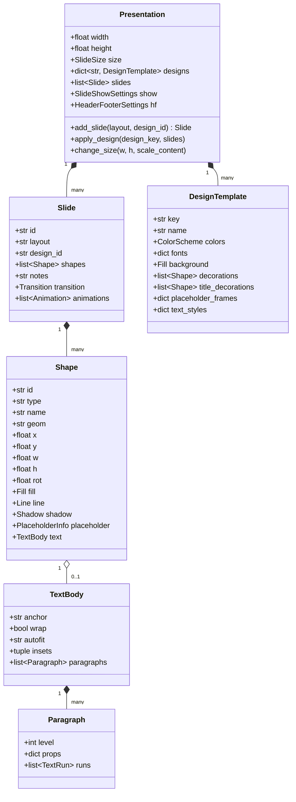

# Technical Specification - Issue #39: Lectern 核心演示文稿对象模型 (Presentation, Master, 21种版式, 15套设计主题与画幅自适应)

## 1. Overview & Context

本规范针对 Issue #39，为 ATBOffice 的演示文稿（Lectern，即 PowerPoint 2003 移植）模块构建纯 Python 3.12+ 的核心对象模型。

作为 Lectern 架构演进的奠基步骤（Step 1 of 15 under Epic #38），本模块负责管理完整演示文稿树：
- 演示文稿容器 (`Presentation`)
- 幻灯片与母版 (`Slide`, `SlideMaster`)
- 21 种经典标准版式 (`SlideLayout`, `M.LAYOUTS`)
- 15 套内置专业设计主题 (`DesignTemplate`, 配色方案 `ColorScheme`、装饰图元 `Decoration`)
- 层次化占位符样式继承树（标题、正文、页眉页脚、日期、页码等 9 级段落样式）
- 16:9 与 4:3 及自定义画幅比例的自由切换与元素自适应重排算法。

本实现严格对照 `.vibeoffice/public/lectern/js/model.js` 与 `.vibeoffice/public/lectern/js/designs.js`。

---

## 2. Requirements & Acceptance Criteria

### Functional Requirements
1. **Core Models**:
   - `Presentation`: 管理幻灯片列表、设计主题表 (`designs`)、演示文稿属性、全局页眉页脚 (`HeaderFooterSettings`)、放映设置 (`SlideShowSettings`)、幻灯片尺寸 (`SlideSize`)。
   - `Slide`: 唯一 ID、所属版式、所用设计主题 ID、图元列表 (`shapes`)、演讲者备注 (`notes`)、切页转场 (`Transition`)、动画列表 (`anims`)、隐藏状态。
   - `Shape`: 基础与几何图元模型，支持 `geom` (92 种 AutoShape 预设)、坐标与尺寸 (`x, y, w, h`)、旋转 (`rot`)、填充 (`Fill`)、轮廓线 (`Line`)、阴影 (`Shadow`)、占位符信息 (`PlaceholderInfo`)、文本体 (`TextBody`)。
   - `TextBody` / `Paragraph` / `TextRun`: 完整的层级文本模型，支持 0-8 级大纲层级缩进、项目符号 (`BulletInfo`)、段前段后距、行距、行内样式（粗体、斜体、下划线、字号、颜色、字体方案 `+mj`/`+mn`）。
2. **21 Standard Layouts (`LAYOUTS`)**:
   - 完整支持 PowerPoint 2003 的 21 种标准版式（Title Slide, Title and Text, Title and 2-Column Text, Blank, Title and Content, 4 Content, Title and Table 等）。
   - 实现 `layout_frames(layout_key, design)`，准确计算各占位符的相对与绝对几何坐标。
3. **15 Professional Design Templates (`DESIGNS`)**:
   - 包含 `default`, `azure`, `night`, `meadow`, `ember`, `graphite`, `blueprint`, `capsule`, `ocean`, `parchment`, `pixel`, `crimson`, `glass`, `radial`, `evergreen` 15 套主题。
   - 完整移植每个主题的 12 槽配色方案、主副字体方案、背景样式（纯色/渐变/图案）、母版装饰矢量图元 (`deco`) 与标题幻灯片特殊装饰 (`titleDeco`)。
4. **Style Resolution & Placeholder Inheritance**:
   - 实现 9 级段落样式的级联解析：默认样式 -> 主题样式 -> 占位符样式 -> 段落覆盖 -> 字符覆盖。
   - 颜色槽位智能映射与解析：`tx1`->`dk1`, `bg1`->`lt1`, `tx2`->`dk2`, `bg2`->`lt2`, `accent1..6`, `hlink`, `folHlink`。
5. **Aspect Ratio & Size Adaptation**:
   - 支持 16:9 宽屏（默认 960x540 pt / 13.33x7.5 in）与 4:3 传统屏幕（720x540 pt / 10x7.5 in）及 A4/Letter 等预设。
   - 切换画幅时，占位符根据目标版式自动重新计算帧几何，普通图元按等比缩放并平移居中。
6. **Layout & Design Application**:
   - `apply_layout`: 重新应用版式时，保留已有文本内容与媒体图元，丢弃空占位符，匹配对应占位符类型。
   - `apply_design`: 切换设计主题，无损更新背景与装饰图元，同步调整占位符样式。
7. **Serialization & History**:
   - 支持序列化为标准 dict / JSON，支持深拷贝克隆 (`dup_slide`, `dup_shape`) 与 Undo/Redo 快照机制。

---

## 3. Architecture & Module Structure

```
src/atboffice/modules/presentation/
├── __init__.py
├── view.py                       # Existing placeholder view
└── models/
    ├── __init__.py               # Re-exports core classes
    ├── presentation.py           # Presentation, SlideSize, SlideShowSettings, HeaderFooterSettings
    ├── slide.py                  # Slide, SlideLayout, Transition, Animation
    ├── shape.py                  # Shape, PlaceholderInfo, Fill, Line, Shadow, Geometry
    ├── text.py                   # TextBody, Paragraph, TextRun, TextStyleLevel, BulletInfo
    ├── designs.py                # 15 built-in DesignTemplates, ColorScheme, ColorResolver
    └── layouts.py                # 21 standard Layout definitions and frame calculator
```

### Data Flow & Class Relationships


---

## 4. Implementation Details

### 4.1 21 Standard Layouts & Dynamic Frame Calculator
标准版式表映射与 `.vibeoffice/public/lectern/js/model.js` 严格一致：
- `title`, `titleOnly`, `text`, `twoText`, `blank`, `contentOnly`, `content`, `twoContent`, `contentTwoContent`, `twoContentContent`, `fourContent`, `textContent`, `contentText`, `textTwoContent`, `twoContentText`, `table`, `chart`, `textOverContent`, `contentOverText`, `vertText`, `vertTitleText`.
- `layout_frames(layout_key, design)` 计算各槽位的 `(x, y, w, h)`：
  - 自动依据设计主题的 `ph.title` 和 `ph.body` 边界框，计算列间距 `gap = round(body.w * 0.0185, 2)`。
  - 双栏左右对半分，四栏网格划分，内容优先自适应。

### 4.2 15 Built-in Design Templates
- `default`: 标准空白/蓝调方案。
- `azure`: 天蓝地平线，顶部双层深蓝装饰横条与金橙强调线。
- `night`: 深邃夜空，带 4 角星形小矢量装饰与柔和椭圆光晕。
- `meadow`: 清新草地，底部平滑双波浪贝塞尔曲线装饰。
- `ember`: 余烬赤红，底部三层渐变色块与左侧边条。
- `graphite`: 石墨质感，斜平行四边形 Accent 图元与细分割线。
- `blueprint`: 经典工程蓝图，带网格图案背景与细线外框。
- `capsule`: 胶囊现代风，顶部圆角矩形装饰徽章。
- `ocean`: 大洋海浪，底部双层渐变波浪装饰曲线。
- `parchment`: 羊皮古卷，径向渐变背景与仿古双细边框。
- `pixel`: 像素马赛克，右上角 4x4 像素方块矩阵装饰。
- `crimson`: 绯红边缘，左侧通顶纯红纵带与水平分割线。
- `glass`: 分层玻璃，半透明旋转磨砂玻璃长方形重叠。
- `radial`: 放射光芒，径向渐变背景加底部柔光椭圆。
- `evergreen`: 常青松木，左侧主标题与右侧墨绿通顶装饰板。

### 4.3 样式继承与解析算法
- `resolve_color(color_spec, design, fallback)`: 智能识别 `#RRGGBB` 十六进制色，或解析主题调色板槽位（`lt1`, `dk1`, `lt2`, `dk2`, `accent1`..`accent6`, `hlink`, `folHlink` 以及别名 `bg1`, `tx1`, `bg2`, `tx2`）。
- 9 级正文字号默认递减 `[32, 28, 24, 20, 20, 20, 20, 20, 20]`，左边距与悬挂缩进严格匹配 PPT 2003 规范。
- 占位符文本提示词国际化（`safe_tr` 支持）。

### 4.4 画幅切换自适应重排算法
- 16:9 (`960x540`) <-> 4:3 (`720x540`):
  - 计算缩放比例 `scale_x = new_w / old_w`, `scale_y = new_h / old_h`。
  - 占位符图元：重新依据目标尺寸下的 `layout_frames` 重新定位与重算大小，保持版式严整。
  - 用户自定义图元：按 `(x * scale_x, y * scale_y, w * scale_x, h * scale_y)` 等比映射，文本字号按最小缩放系数 `min(scale_x, scale_y)` 平滑缩放。

---

## 5. Verification Plan
- **Unit Tests (`tests/unit/presentation/test_pmodel.py`)**:
  1. `test_new_presentation_defaults`: 验证默认 16:9 尺寸、默认版式、单张标题幻灯片与占位符生成。
  2. `test_21_layouts_frames`: 遍历全部 21 种标准版式，断言生成的占位符类型、数量及边界坐标均在幻灯片画幅内部且无重叠冲突。
  3. `test_15_design_templates`: 遍历全部 15 套内置设计主题，验证配色方案 12 槽完备、装饰图元正确生成、字体方案完整。
  4. `test_style_resolution_and_color_mapping`: 测试各种颜色引用槽（如 `accent1`, `tx1`, `bg2`）与 9 级文本层级的层级样式继承与覆盖。
  5. `test_apply_layout_content_preservation`: 验证在幻灯片已有文字内容时切换版式，已有段落文字 100% 迁移至新版式占位符，空占位符被剔除。
  6. `test_apply_design`: 验证在多张幻灯片上切换不同设计主题，装饰图元与背景正确更新。
  7. `test_aspect_ratio_resize_16_9_to_4_3`: 验证画幅在 16:9 与 4:3 互相切换时，占位符智能贴合，普通图元等比缩放且字号按比例调整。
  8. `test_slide_crud_and_duplication`: 验证幻灯片增删改查、克隆 (`dup_slide`) 产生新 ID 但保留完整图元结构、深拷贝解耦。
  9. `test_serialization_roundtrip`: 验证 `to_dict()` 与 `from_dict()` 无损往返还原。
