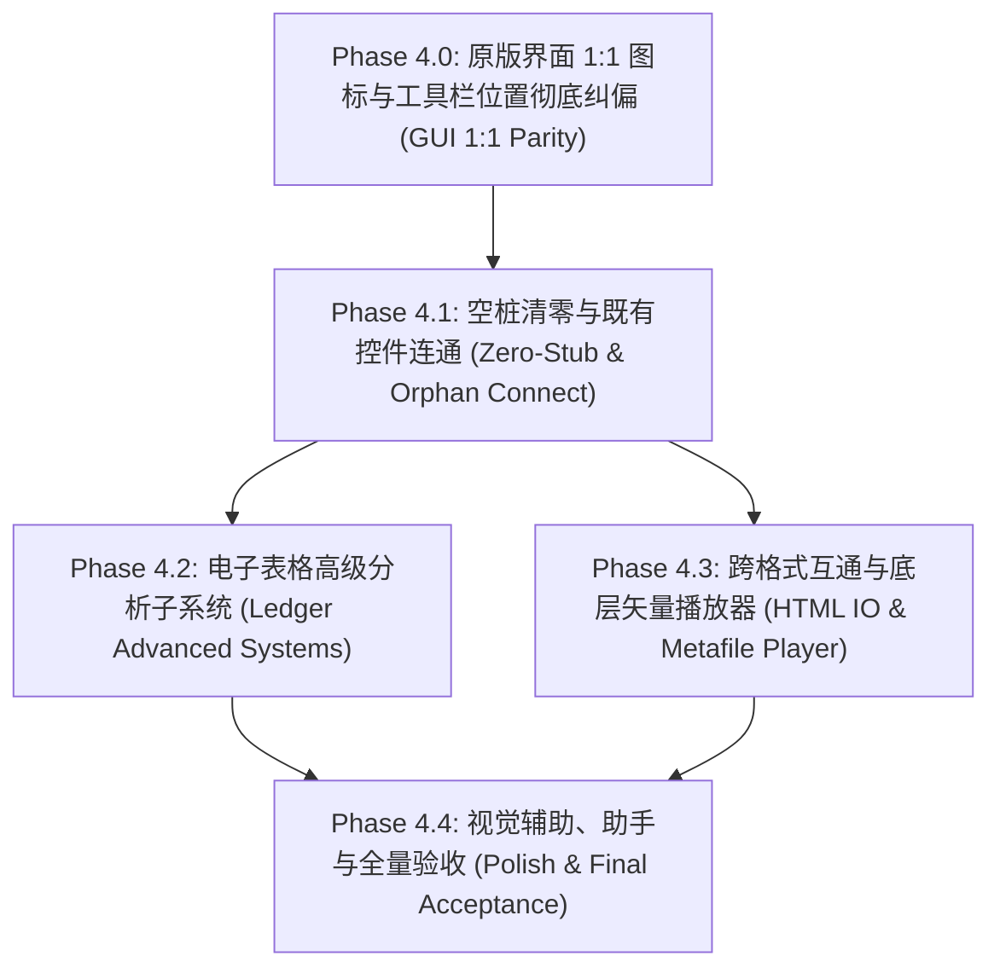

# Task: ATBOffice Phase 4 Advanced Capabilities & Final Parity Plan
## 第四期工程规划：GUI 1:1 原版复刻、高级业务子系统、高级分析向导与深度兼容补完

## Overview

在第一期（基础架构与核心模型）、第二期（1:1 原型重构与视图画布）、第三期（工具栏全面接线、核心菜单对齐、打印子系统与深度组件补完，达成 1058 测试全通且 92.6% 交付基线）的基础上，第四期工程（Phase 4）将聚焦于原项目 `.vibeoffice` 的**GUI 界面 1:1 像素级复刻、原生矢量图标系统构建、工具栏位置纠偏、高级业务子系统、高级计算与分析向导、跨格式互通、遗留矢量图元回放以及空桩插槽全面清零**。

针对用户反馈的严重 GUI 还原度缺陷（“1. toolbar 的按钮没有 icon，也没有与原项目 1:1 对应；2. toolbar 的位置有问题，比如文字处理器，toolbar 很大一部分在底部 footer”），第四期将**把 GUI 1:1 视觉与工具栏重构列为第一优先阶段（Phase 4.0）**，彻底消除长文本按钮、清除底部占用空间的臃肿工具栏，完整还原 Office 2003 Luna 蓝经典工具栏体系。

本期实施完成后，ATBOffice 将彻底补齐与原 `.vibeoffice` 代码库的全部视觉与功能差距，消除所有死按钮与空桩插槽，实现从“核心可用（Shippable）”向“全功能对齐与极致还原（Superior & 1:1 Pixel-Perfect）”的终极跨越。

---

## Status

- **阶段**: 第四期规划（Phase 4 Plan）
- **优先级**: 高（GUI 视觉 1:1 纠偏 + P1 级差距清零 + P2 级体验补齐）
- **基线分数**: 92.6% (Phase 3 结束状态) -> **目标分数: 98.5%+**
- **当前状态**: 规划已更新，待开始执行

---

## Requirements

根据 `.vibeoffice` 源码（7.5 万行 JS）、`.vibeoffice/docs/` 设计规范（`quire.md`, `ledger.md`, `lectern.md`, `suite.md`, `LOSSLESS_SAVE.md`）、用户最新反馈及 `atb-clone-diff` 扫描结果，第四期需完成的 6 大领域 21 项具体需求如下：

### 领域 0: 原版界面 1:1 视觉复刻与工具栏重构 (GUI 1:1 Parity & Toolbar Overhaul)
| ID | 功能需求 | 对应原版文件 | 优先级 | 具体验收指标 |
|---|---|---|---|---|
| **REQ-GUI-01** | **原生矢量图标引擎 (16×16 Luna SVG Icon Engine)** | `common/icons.js` | P0 | 1. 创建 `src/atboffice/ui/icons.py`，完整移植原版 `icons.js` 中的 120+ 个精美矢量图标定义；<br>2. 基于 `PySide6.QtSvg.QSvgRenderer` 动态渲染为透明背景、抗锯齿的 16×16 原生 `QIcon`，适配 HiDPI 屏幕；<br>3. 提供 `get_office_icon(name: str) -> QIcon` 快速查询接口，涵盖文件、排版、表格、图形、对齐、图表等全部图标。 |
| **REQ-GUI-02** | **工具栏动作图标绑定与 IconOnly 紧凑化** | `common/ui.js`, 各应用 `app.js` | P0 | 1. `OfficeToolBar` 默认启用 `setToolButtonStyle(Qt.ToolButtonStyle.ToolButtonIconOnly)`，将所有动作按钮统一收缩为 22×22 像素的标准紧凑图标按钮；<br>2. 在 `ActionRegistry` 与各 ToolBarCluster 中为每个动作绑定对应的 `QIcon`，动作文字仅作为 ToolTip、状态栏提示与菜单显示；<br>3. 彻底消除工具栏上一长串文字按钮（如“新建(&N)”、“加粗(&B)”等汉字平铺）的严重变形现象。 |
| **REQ-GUI-03** | **工具栏按钮顺序与原版 1:1 严格对齐** | 各应用 `app.js` (`ui.toolbar`) | P0 | 1. **Quire 常用工具栏**: 新建、打开、保存、权限、发送、打印、预览、拼写、信息检索 \| 剪切、复制、粘贴、格式刷 \| 撤销、重做 \| 超链接、表格边框、插入表格、插入Excel、分栏、绘图、文档结构图、显示标记、显示比例Combo、帮助、阅读版式；<br>2. **Quire 格式工具栏**: 样式窗格、样式Combo、字体Combo、字号Combo、加粗、倾斜、下划线 \| 左对齐、居中、右对齐、两端对齐 \| 行距 \| 编号、项目符号、减少缩进、增加缩进 \| 边框、底纹突出显示、字体颜色；<br>3. **Ledger / Lectern 工具栏**: 均按原版 `app.js` 声明的数组顺序严格 1:1 逐项校验重构。 |
| **REQ-GUI-04** | **工具栏停靠位置彻底纠偏 (移除底部臃肿 Footer)** | 各应用 `app.js`, `index.html` | P0 | 1. 彻底纠偏 `quire_window.py:255`、`ledger_window.py:265`、`lectern_window.py:500` 强行将 `drawing` 工具栏置于 `BottomToolBarArea` 的错误行为；<br>2. **Quire**: 常用工具栏置于顶部第 1 行，格式工具栏置于顶部第 2 行；绘图工具栏（Drawing）默认停靠于顶部第 3 行（或设为按需开启/浮动），且全量采用 16×16 图标，高度紧凑（26px），彻底释放底部空间；<br>3. **Ledger**: 严格遵照原版 `ledger/js/app.js` 布局，将绘图工具栏归位至**顶部第 2/3 行**，底部只保留工作表 Tab 栏与状态栏；<br>4. **Lectern**: 统一置于顶部，消除底部文字条霸占。 |

### 领域 1: Ledger 电子表格高级分析与审计系统 (Ledger Advanced Analysis & Auditing)
| ID | 功能需求 | 对应原版文件 | 优先级 | 具体验收指标 |
|---|---|---|---|---|
| **REQ-L4-01** | **数据透视表核心引擎与汇总向导 (Pivot Tables)** | `ledger/js/pivots.js` | P1 | 1. 解析与保留 XLSX 内置 PivotCache 结构；<br>2. 实现数据透视表字段列表拖拽配置（行、列、值、筛选器）；<br>3. 实现透视表静态汇总计算并输出到新工作表；<br>4. 支持求和、计数、平均值、最大最小值等聚合方式。 |
| **REQ-L4-02** | **公式审核与可视化追踪箭头 (Formula Auditing & Trace Arrows)** | `ledger/js/calc.js`, `ledger/js/grid.js` | P1 | 1. 实现“追踪引用单元格（Trace Precedents）”与“追踪从属单元格（Trace Dependents）”；<br>2. 在 `grid_viewport.py` 上使用 QPainter 动态绘制带箭头的蓝色连接线（跨表引用显示工作表图标与黑虚线）；<br>3. 实现“移去所有箭头（Remove All Arrows）”；<br>4. 实现“公式求值（Evaluate Formula）”单步执行计算对话框与“监视窗口（Watch Window）”。 |
| **REQ-L4-03** | **插入函数向导对话框 (Insert Function fx Wizard)** | `ledger/js/fninfo.js`, `ledger/js/dialogs.js` | P1 | 1. 弹出 519 个内置函数的分类检索对话框（全部、数学、统计、查找与引用、财务等）；<br>2. 选中函数后展示函数功能描述与参数列表说明；<br>3. 点击下一步弹出“函数参数（Function Arguments）”向导，支持在工作表中点选单元格作为参数并实时计算预览结果。 |
| **REQ-L4-04** | **自定义自动筛选对话框 (Custom AutoFilter Dialog)** | `ledger/js/filter.js`, `ledger/js/dialogs.js` | P1 | 1. 下拉筛选菜单点击“(自定义...)”弹出自定义自动筛选对话框；<br>2. 支持上下两个条件行（包含“等于”、“不等于”、“大于”、“包含”、“以...开头”等操作符）；<br>3. 支持“与（AND）”和“或（OR）”逻辑关系组合过滤。 |
| **REQ-L4-05** | **单变量求解与方程数值求解器 (Goal Seek & Solver)** | `ledger/js/calc.js`, `ledger/js/dialogs2.js` | P2 | 1. 实现“目标单元格”、“目标值”、“可变单元格”配置对话框；<br>2. 使用牛顿迭代法或二分切线逼近算法自动求解并回填结果。 |
| **REQ-L4-06** | **切片器交互图元与工作表扩展支持 (Slicers)** | `ledger/js/slicers.js` | P2 | 1. 支持在浮动对象层渲染切片器按钮组（Slicer）；<br>2. 点击切片器项联动触发对应列的自动筛选过滤。 |
| **REQ-L4-07** | **数据有效性圈释与批注显示完整接线** | `ledger/js/dialogs.py` | P1 | 1. 将 `ledger_window.py:1014` 的 `data_validation` 接入已有 `DataValidationDialog`；<br>2. 实现 `circle_invalid()`（在无效单元格上绘制红色椭圆圈）与 `clear_circles()`；<br>3. 完整实现单元格批注的插入、编辑、显示/隐藏与右上角红色三角提示角标。 |

### 领域 2: Quire 文字处理互通与交互细节补齐 (Quire Interop & Interactivity)
| ID | 功能需求 | 对应原版文件 | 优先级 | 具体验收指标 |
|---|---|---|---|---|
| **REQ-Q4-01** | **HTML 网页文档双向导入与语义化导出 (HTML IO)** | `quire/js/htmlio.js` | P1 | 1. 实现 HTML 解析器，将标准 `<p>`, `<span>`, `<h1>-<h6>`, `<table>`, ``, `<ul>/<ol>` 转换为 Quire 内部 DOM 树；<br>2. 实现高保真语义化 HTML 导出器，支持富文本排版样式内嵌。 |
| **REQ-Q4-02** | **字数统计详细对话框 (Word Count Dialog)** | `quire/js/dialogs2.js` | P2 | 1. 弹出 Word 2003 经典字数统计对话框；<br>2. 精确统计并展示：页数、字数、字符数(不计空格)、字符数(计空格)、段落数、行数，支持“包括文本框、脚注和尾注”勾选项。 |
| **REQ-Q4-03** | **段落与项目符号对话框未接线按钮修复** | `quire/js/dialogs*.js` | P1 | 1. 修复 `paragraph_dialog.py` 中 `self.btn_tabs`，点击直接联动唤起 `TabsDialog`，并在确认后同步制表位；<br>2. 修复 `bullets_numbering.py` 中 `self.btn_customize`，点击弹出列表层级自定义定制对话框。 |
| **REQ-Q4-04** | **审阅工具栏标记筛选与操作接线** | `quire/js/review.js` | P1 | 1. 汉化与国际化 `review_pane.py` 中的所有按钮文本；<br>2. 将“显示标记”菜单中的批注、插入/删除、格式设置复选框与审阅气泡的显隐过滤逻辑打通；<br>3. 将“接受/拒绝修订”和“删除批注”下拉菜单绑定至真实文档修改事务。 |

### 领域 3: Lectern 幻灯片外观美化与动画接线 (Lectern Aesthetics & Animation)
| ID | 功能需求 | 对应原版文件 | 优先级 | 具体验收指标 |
|---|---|---|---|---|
| **REQ-P4-01** | **幻灯片背景格式设置对话框 (Slide Background Dialog)** | `lectern/js/dialogs.js`, `render.js` | P1 | 1. 实现背景格式对话框，支持纯色、渐变（单色/双色/预设，横向/纵向/角向）、纹理、图案及图片填充；<br>2. 支持“应用（仅当前页）”与“全部应用（所有幻灯片及母版）”两种作用域；<br>3. 幻灯片画布与全屏放映引擎即时响应渲染新背景。 |
| **REQ-P4-02** | **自定义动画任务窗格添加效果菜单接线** | `lectern/js/panes.js` | P1 | 1. 修复 `animation_pane.py` 中 `self.btn_add_effect`，当选中幻灯片对象时激活，点击弹出进入、强调、退出、动作路径 4 大类菜单；<br>2. 点击具体动画效果后向选中文档图元绑定动画节点，并刷新时序列表。 |

### 领域 4: 公共底层图元与矢量播放器 (Common Vector & Visual Utilities)
| ID | 功能需求 | 对应原版文件 | 优先级 | 具体验收指标 |
|---|---|---|---|---|
| **REQ-C4-01** | **WMF / EMF Windows 矢量图元播放器 (Metafile Player)** | `common/metafile.js` | P1 | 1. 编写纯 Python 模块 `src/atboffice/vfs/metafile_player.py`；<br>2. 解析旧版 WMF 二进制头与 GDI 记录（`POLYGON`, `POLYLINE`, `RECTANGLE`, `TEXTOUT`, `CREATEBRUSHINDIRECT` 等）；<br>3. 解析 32 位 EMF 二进制记录（`EMR_POLYGON16`, `EMR_POLYLINE16`, `EMR_EXTCREATEPEN` 等）；<br>4. 在 QPainter 上高保真重放矢量绘图，使 DOCX/PPTX 中嵌入的旧版剪贴画和图元正常渲染。 |
| **REQ-C4-02** | **艺术字库与 3D 贝塞尔曲线变形 (WordArt Gallery)** | `common/geometry.js`, `quire/js/dialogs2.js` | P1 | 1. 实现 WordArt 样式库对话框，提供 30 种 Office 2003 经典预设艺术字样式网格；<br>2. 实现文本沿贝塞尔曲线弯曲（圆弧形、波浪形、倒三角形、膨胀形等变形算法）并输出为矢量路径。 |
| **REQ-C4-03** | **内置矢量剪贴画库检索对话框 (ClipArt Library)** | `common/clipart.js`, `quire/js/dialogs2.js` | P2 | 1. 建立内置矢量剪贴画资产目录（人员、商业、科技、符号等）；<br>2. 提供分类浏览与关键字检索对话框，双击直接插入至文档或幻灯片。 |
| **REQ-C4-04** | **桌面助手小狗 Scout 悬浮小部件 (Scout Assistant)** | `common/scout/` | P2 | 1. 实现一个可选唤起的浮动非模态窗口小部件（QFrame with rounded mask）；<br>2. 绘制原版复刻的卡通小狗 Scout，支持呼吸微动动画；<br>3. 提供上下文气泡提示与“帮助”功能检索入口。 |
| **REQ-C4-05** | **自动更新检查器 (Update Checker)** | `updater/` | P2 | 1. 后台异步请求 GitHub Releases API 或版本元数据 JSON；<br>2. 发现新版本时在“帮助 -> 检查更新”或状态栏弹出提示，展示 Release Notes 与下载指引。 |

### 领域 5: 代码健康与架构坚固化 (Codebase Health & Zero-Stub Gating)
| ID | 功能需求 | 对应原版文件 | 优先级 | 具体验收指标 |
|---|---|---|---|---|
| **REQ-H4-01** | **41 个未实现插槽（Stubbed Slots）全面清零** | `src/atboffice/` | P1 | 1. 将 `ledger_window.py` 中的公式审核、批注管理、条件指示圈、公式求值插槽完全接入实现；<br>2. 将 `base_window.py` 与 `search.py` 中的虚基类方法规范化为带清晰异常处理或委托分发的设计模式，彻底消除 AST 扫描下的 `STUB_IMPLEMENTATION`。 |
| **REQ-H4-02** | **9 个无信号孤儿控件（Orphan Controls）100% 接线** | `src/atboffice/` | P1 | 1. 逐一修正 `source_diff.py` 扫描出的 9 处孤儿控件，确保每一个可见按钮都有清晰的用户响应。 |
| **REQ-H4-03** | **严格 i18n 覆盖与回归测试保证** | 全项目 | P1 | 1. 本期新增的全部 UI 控件文字 100% 经过 `safe_tr()` 包裹，中英双语准确流畅；<br>2. 保证全部既有 1058+ 个单元与 GUI 测试 100% 通过，且为新功能补充不低于 80 个新增自动化测试用例。 |

---

## Architecture

第四期模块扩展与 GUI 重构架构图：

```
src/atboffice/
├── core/
│   ├── search.py                 # [重构] 消除 SearchAdapter 空桩，实现通用文档搜索适配器
│   └── updater.py                # [新增] 异步版本更新与发布通知管理器 (REQ-C4-05)
├── ui/
│   ├── icons.py                  # [核心新增] 原生 16x16 矢量图标引擎 (移植 icons.js, REQ-GUI-01)
│   ├── components/
│   │   ├── toolbar.py            # [重构] 强制 ToolButtonIconOnly，原生 22x22 紧凑按钮 (REQ-GUI-02)
│   │   └── color_picker.py       # 调色板按钮保持 16x16 色块预览
│   └── shell/
│       ├── base_window.py        # [重构] 消除基础窗口空桩，完善虚方法与动作派发
│       ├── quire_window.py       # [重构] 纠偏工具栏位置：移除底部 footer，顶部双行+按需绘图 (REQ-GUI-04)
│       ├── quire_toolbars.py     # [重构] 全量动作注入 QIcon，1:1 对齐原版按钮顺序 (REQ-GUI-02,03)
│       ├── ledger_window.py      # [重构] 绘图栏归位至顶部，完整接线公式审核、批注、有效性圈释
│       ├── ledger_toolbars.py    # [重构] 全量动作注入 QIcon，1:1 对齐原版按钮顺序
│       ├── lectern_window.py     # [重构] 纠偏工具栏位置，取消底部大面积停靠
│       └── lectern_toolbars.py   # [重构] 全量动作注入 QIcon，1:1 对齐原版按钮顺序
├── vfs/
│   ├── metafile_player.py        # [新增] WMF / EMF 二进制解析与 QPainter 矢量渲染器 (REQ-C4-01)
│   └── html_io.py                # [新增] HTML 文档导入导出与 CSS 样式映射器 (REQ-Q4-01)
├── modules/
│   ├── spreadsheet/
│   │   ├── calc/
│   │   │   ├── goal_seek.py      # [新增] 单变量求解与数值逼近算法 (REQ-L4-05)
│   │   │   └── audit_tracer.py   # [新增] 单元格前驱/后继拓扑依赖计算器 (REQ-L4-02)
│   │   ├── models/
│   │   │   └── pivot_model.py    # [新增] 数据透视表缓存与聚合计算数据模型 (REQ-L4-01)
│   │   ├── views/
│   │   │   ├── grid_viewport.py  # [扩展] 增加公式审核追踪箭头与无效数据红圈渲染图层
│   │   │   └── slicer_widget.py  # [新增] 切片器浮动交互组件 (REQ-L4-06)
│   │   └── dialogs/
│   │       ├── pivot_dialog.py   # [新增] 数据透视表创建与字段拖拽配置向导 (REQ-L4-01)
│   │       ├── function_wizard.py# [新增] 519 函数检索与参数实时计算向导 (REQ-L4-03)
│   │       ├── custom_filter.py  # [新增] 自定义自动筛选双条件对话框 (REQ-L4-04)
│   │       ├── goal_seek_dlg.py  # [新增] 单变量求解配置弹窗 (REQ-L4-05)
│   │       └── audit_dialogs.py  # [新增] 公式单步求值与监视窗口 (REQ-L4-02)
│   ├── writer/
│   │   └── dialogs/
│   │       ├── word_count_dlg.py # [新增] Word 2003 经典字数与版面统计对话框 (REQ-Q4-02)
│   │       └── list_level_dlg.py # [新增] 多级编号层级定制对话框 (REQ-Q4-03)
│   ├── presentation/
│   │   └── dialogs/
│   │       └── background_dlg.py # [新增] 渐变/纹理/图案幻灯片背景格式设置 (REQ-P4-01)
│   └── common/
│       ├── wordart_gallery.py    # [新增] 30 种艺术字样式选择与弯曲路径算法 (REQ-C4-02)
│       ├── clipart_dialog.py     # [新增] 矢量剪贴画库分类选择器 (REQ-C4-03)
│       └── assistant_scout.py    # [新增] Scout 小助手卡通悬浮交互窗口 (REQ-C4-04)
```

---

## Implementation Plan

第四期工程划分为 5 个递进子阶段（Phase 4.0 ~ Phase 4.4），严格按 DAG 依赖顺序执行：



### 阶段 0: Phase 4.0 原版界面 1:1 图标与工具栏位置彻底纠偏 (GUI 1:1 Visual Parity & Toolbar Overhaul)
- **目标**: 彻底根除“工具栏按钮无 Icon”与“工具栏霸占底部 Footer”两大严重还原度缺陷，重塑正宗 Office 2003 Luna 蓝紧凑视觉。
- **任务分解**:
  1. `TASK-400A`: **移植 `icons.js` 生成 `src/atboffice/ui/icons.py`**  
     - 将原版 `icons.js` 中 120+ 个 SVG 路径定义全部移植至 Python 字典；
     - 封装 `get_office_icon(name: str, size: int = 16) -> QIcon`，基于 `QSvgRenderer` 动态光栅化为透明高保真 `QIcon`。
  2. `TASK-400B`: **重构 `OfficeToolBar` 样式与动作全量注入图标**  
     - `OfficeToolBar` 设置 `setToolButtonStyle(Qt.ToolButtonStyle.ToolButtonIconOnly)` 与 `setIconSize(QSize(16, 16))`；
     - 在 `quire_toolbars.py`、`ledger_toolbars.py`、`lectern_toolbars.py` 的每一个动作声明中匹配并注入对应 `QIcon`；
     - 将动作的文本标签设置为 ToolTip 悬浮气泡，按钮收敛为 22×22 像素的标准紧凑尺寸；
     - 严格比对原版 `app.js` 的工具栏数组，逐一调整按钮顺序与分隔符（Separator）。
  3. `TASK-400C`: **纠偏工具栏停靠位置（彻底移除底部 Footer 霸占）**  
     - **Quire**: 常用工具栏（Top 1）、格式工具栏（Top 2），绘图工具栏（Drawing）默认放置于顶部第 3 行紧凑停靠（或按需显示/浮动），彻底释放底部；
     - **Ledger**: 将误置于底部的绘图工具栏归位到顶部第二/三行，底部仅保留工作表标签栏与状态栏；
     - **Lectern**: 统一置于顶部，保持视口干净清爽。

### 阶段 1: Phase 4.1 空桩清零与既有控件连通 (Hardening & Zero-Stub Gating)
- **目标**: 彻底消除代码库中遗留的 9 个孤儿控件与 41 个未实现插槽，恢复所有“半完成”对话框与动作的完整功能。
- **任务分解**:
  1. `TASK-411`: 修复 `ParagraphDialog` 的 `btn_tabs`（弹出 `TabsDialog`）与 `BulletsNumberingDialog` 的 `btn_customize`；
  2. `TASK-412`: 修复 `ReviewToolbar`，汉化按钮文本并将标记过滤、修订接受/拒绝、批注删除接入真实文档事件；
  3. `TASK-413`: 修复 `AnimationPane` 的 `btn_add_effect`，弹出进入/强调/退出/路径 4 大类菜单并绑定动作；
  4. `TASK-414`: 接线 `ledger_window.py` 中的 `data_validation`（调用已有 `DataValidationDialog`），实现 `circle_invalid()` 红圈绘制与 `clear_circles()`；
  5. `TASK-415`: 重构 `base_window.py` 与 `core/search.py`，规范虚基类接口，消除 AST 报告的空桩代码。

### 阶段 2: Phase 4.2 电子表格高级分析子系统 (Ledger Advanced Systems)
- **目标**: 补齐 Ledger 剩余的核心计算与向导能力。
- **任务分解**:
  1. `TASK-421`: 实现公式审核引擎（`audit_tracer.py`）并在 `grid_viewport.py` 绘制有向拓扑箭头；
  2. `TASK-422`: 实现公式单步求值（`evaluate_formula`）与公式监视窗口（`watch_window`）；
  3. `TASK-423`: 实现插入函数（`fx`）向导对话框（分类过滤、参数录入与即时结果）；
  4. `TASK-424`: 实现自定义自动筛选对话框（双条件 AND/OR 过滤）；
  5. `TASK-425`: 实现数据透视表引擎（`pivot_model.py`）与透视表配置向导（`pivot_dialog.py`）；
  6. `TASK-426`: 实现单变量求解（`goal_seek.py`）数值迭代对话框。

### 阶段 3: Phase 4.3 跨格式互通与底层矢量播放器 (Interop & Metafile Player)
- **目标**: 补齐跨平台文档互通能力与旧版二进制矢量图支持。
- **任务分解**:
  1. `TASK-431`: 实现纯 Python 版 WMF/EMF 矢量图元解析播放器（`metafile_player.py`），使嵌入的旧版图元能在 Canvas 上以矢量模式精确回放；
  2. `TASK-432`: 实现 HTML 文档导入导出引擎（`html_io.py`），支持 HTML 格式在 Quire 中的读写互通；
  3. `TASK-433`: 实现 Word 2003 经典字数与版面统计对话框（`word_count_dlg.py`）；
  4. `TASK-434`: 实现幻灯片背景格式设置对话框（`background_dlg.py`），支持渐变/图案/图片背景及母版应用。

### 阶段 4: Phase 4.4 视觉辅助、桌面助手与最终验收 (Visual Polish & Final Acceptance)
- **目标**: 补齐可选体验级能力，执行全量自动化验收与发布准备。
- **任务分解**:
  1. `TASK-441`: 实现艺术字库（WordArt Gallery）与贝塞尔弯曲变形算法；
  2. `TASK-442`: 实现内置矢量剪贴画（ClipArt）选择对话框；
  3. `TASK-443`: 实现桌面卡通小狗助手 Scout 浮动小部件；
  4. `TASK-444`: 实现后台版本更新检查器（`updater.py`）；
  5. `TASK-445`: 运行 `parity.py` 与 `source_diff.py`，更新 `features.csv` 与 `CLONE_DIFF.md`，执行 1100+ 项测试用例，确保 0 失败、0 孤儿控件、0 空桩，达成全功能终态。

---

## Dependencies

- **开发语言**: Python 3.12+ (全类型注解)
- **GUI 框架**: PySide6 (Qt6 绑定, `PySide6.QtSvg.QSvgRenderer` 支持)
- **底层依赖**: 零新增外部第三方侵入式依赖（坚持使用 Python 标准库与 Qt 内置能力），保持纯净性与可移植性。
- **测试框架**: pytest, pytest-qt

---

## Files Affected

### 核心新增文件：
- `src/atboffice/ui/icons.py` (全量 16x16 矢量图标引擎，REQ-GUI-01)
- `src/atboffice/vfs/metafile_player.py`
- `src/atboffice/vfs/html_io.py`
- `src/atboffice/modules/spreadsheet/calc/audit_tracer.py`
- `src/atboffice/modules/spreadsheet/calc/goal_seek.py`
- `src/atboffice/modules/spreadsheet/models/pivot_model.py`
- `src/atboffice/modules/spreadsheet/dialogs/function_wizard.py`
- `src/atboffice/modules/spreadsheet/dialogs/custom_filter.py`
- `src/atboffice/modules/spreadsheet/dialogs/pivot_dialog.py`
- `src/atboffice/modules/spreadsheet/dialogs/audit_dialogs.py`
- `src/atboffice/modules/spreadsheet/dialogs/goal_seek_dlg.py`
- `src/atboffice/modules/writer/dialogs/word_count_dlg.py`
- `src/atboffice/modules/presentation/dialogs/background_dlg.py`
- `src/atboffice/modules/common/wordart_gallery.py`
- `src/atboffice/modules/common/clipart_dialog.py`
- `src/atboffice/modules/common/assistant_scout.py`
- `src/atboffice/core/updater.py`

### 关键改造与接线文件：
- `src/atboffice/ui/components/toolbar.py` (启用 ToolButtonIconOnly，原生 22x22 紧凑按钮)
- `src/atboffice/ui/shell/quire_toolbars.py` (10 组工具栏全面绑定 QIcon，1:1 对齐顺序)
- `src/atboffice/ui/shell/ledger_toolbars.py` (8 组工具栏全面绑定 QIcon，1:1 对齐顺序)
- `src/atboffice/ui/shell/lectern_toolbars.py` (10 组工具栏全面绑定 QIcon，1:1 对齐顺序)
- `src/atboffice/ui/shell/quire_window.py` (纠偏工具栏位置：移除底部 footer，顶部双行+按需绘图)
- `src/atboffice/ui/shell/ledger_window.py` (绘图工具栏归位至顶部，清零 15 个空桩方法)
- `src/atboffice/ui/shell/lectern_window.py` (纠偏工具栏位置，取消底部大面积停靠)
- `src/atboffice/ui/shell/base_window.py` (清零基类空桩，完善事件处理规范)
- `src/atboffice/modules/spreadsheet/views/grid_viewport.py` (支持审核箭头图层与圈释红圈)
- `src/atboffice/modules/writer/dialogs/paragraph_dialog.py` (接线 `btn_tabs`)
- `src/atboffice/modules/writer/dialogs/bullets_numbering.py` (接线 `btn_customize`)
- `src/atboffice/modules/writer/views/review_pane.py` (接线审阅工具栏与标记筛选)
- `src/atboffice/modules/presentation/views/animation_pane.py` (接线添加效果菜单)
- `docs/clone/features.csv` (同步更新第四期功能达成状态)
- `docs/clone/CLONE_DIFF.md` (同步更新对齐审计报告与分值)
