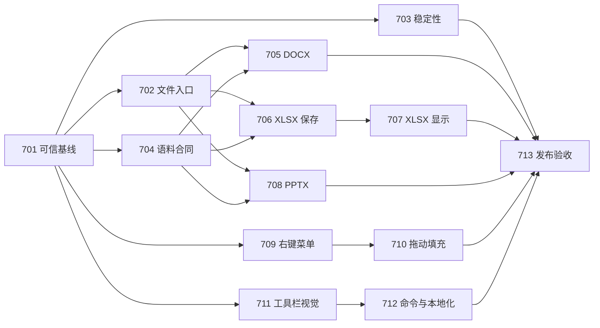

# Task: ATBOffice 第七期完善工程 Implementation Plan

> **For agentic workers:** REQUIRED SUB-SKILL: Use `executing-plans`，或在用户选择分派执行时使用 `subagent-driven-development`，逐任务执行。以下复选框用于记录实际实施进度。

**Goal:** 修复真实使用中的崩溃、错误加载与保存丢失，恢复 Ledger 右键菜单和拖动填充，并按原版逐项校准工具栏。

**Architecture:** 保留现有 Python/PySide6 架构，以原版行为、真实文档和完整窗口事件链为依据补齐实现。建立“入口 → 模型 → 渲染 → 编辑 → 保存重开”的证据链；将截图、解析、显示、无损保存和稳定性分别验收。

**Tech Stack:** Python 3.12+、PySide6/Qt6、pytest、pytest-qt、conda `ATBOffice`；macOS 优先，Fusion 样式及原生菜单栏。

**Spec:** [第七期差异审计及任务卡](../clone/CLONE_DIFF.md)、[原始移植设计](../superpowers/specs/2026-10-24-vibeoffice-pyside6-port-design.md)。

## Overview

本期以修复和真实验收为目标。用户已澄清：“右键拖动”实际指 **右键菜单操作缺失、拖动填充功能缺失**；不新增未经要求的右键拖放菜单。本期规划与审计未修改产品源码；后续已按用户要求创建 GitHub Epic 与 13 个子任务，见 [任务索引](../clone/PHASE7_GITHUB_ISSUES.md)。

第六期已有大量实现，但完成标记与可验证行为存在差距。本期继承有效成果，重新验证有问题的路径，不重写整套 UI，也不把之前任务重新标记为尚未实现。

## Status

- 规划日期：2026-11-03；GitHub 任务核验日期：2026-11-04；状态：**规划与任务登记完成，实施未开始**。
- GitHub：[Epic #234](https://github.com/aitobox/ATBOffice/issues/234)，13 个子任务 #235–#247；[完整映射](../clone/PHASE7_GITHUB_ISSUES.md)。
- 目标基线：`f423efd2609eefcfb5cb32d5d32f4eaef472a5ee`。
- 原版基线：`32ff53a5da0e75ebac11acdb0251cd3d8c7bf408`。
- 本机验证：Python 3.12.0、PySide6 6.11.1，`QT_QPA_PLATFORM=offscreen`。
- 发布判断：**NOT SHIPPABLE**。已确认假成功加载、Strict DOCX 空内容及 XLSM 宏部件丢失；用户报告的持续崩溃尚待原生环境复现。
- 工作量估计：约 **29–48 工程日**，不含原生二进制 Office 格式解析器；先完成第一里程碑后按真实失败簇重新估算，不能以时间到期替代验收。

## Global Constraints

1. 源码严格放在 `src/atboffice/`，Python 3.12+，新增接口完整类型标注；遵循现有 Qt 生命周期和模型分层。
2. 每项修复先列边界，再读 `.vibeoffice/` 对应实现，再增加能够暴露问题的回归。不能只检查按钮存在或函数返回成功。
3. 所有新增/修改 UI 文案使用 `tr()`/`safe_tr()`，实现 `retranslate_ui`；按现有 9 locale 验证动态切换及地道翻译，不能仅检查 JSON 键数。
4. 输入语料只读；保存测试使用临时副本。未修改的未知 XML、媒体、VBA 等部件按原设计保留；不能为显示成功而丢弃内容。
5. 原版不支持的 `.doc/.xls/.ppt` 首先达到准确识别、清晰拒绝和无状态损坏。原生二进制编辑/外部转换属于单独扩展项目，不作为本期隐含承诺。
6. 不熟悉的算法先比较活跃、许可证明确的开源实现，并记录来源、版本与许可证；选型验证前不增加依赖。
7. 截图不可用主窗口/空白图替代失败场景；旧截图与旧报告保留，不能覆盖为“通过”。

## Review Focus

- **损坏、加密、扩展名伪装及不支持文件**：打开失败保持旧模型、路径、dirty、撤销和最近记录不变；TASK-702/704。
- **拖动时切表、关闭、失焦、第二按键或编辑验证失败**：不提交、不遗留定时器/预览；TASK-703/710。
- **整列/整行、多选、隐藏/合并/冻结、保护单元格**：操作有界、不越权、一次撤销恢复；TASK-709/710。
- **有宏、未知关系、图表、修订的真实文档**：只读打开与另存不丢失未知内容，局部编辑只改变必要部分；TASK-705/706/708。
- **Retina、中文/长文案、菜单弹出和对象覆盖层**：绘制与命中区域一致，切换状态/语言不重复触发动作；TASK-711/712。

## 已核实的主要问题

| 证据 | 发现 | 本期响应 |
|---|---|---|
| 第六期 IMGDIFF_REPORT | 阈值 85%，平均 80.97%，仅 75/412 达标，与总结“全面超越”不一致 | 重建发布证据和图像门禁 |
| 截图哈希及捕获源码 | Quire 175 张只有 18 个唯一哈希；Ledger 131 张只有 10 个；Lectern 96 张只有 14 个。脚本存在未匹配及异常 fallback | 状态断言、独立重置、失败显式记账 |
| 三窗口 `do_open` | 未处理扩展名落到 `return True`，上层随后更新路径并清 dirty | 格式能力表及事务化打开 |
| `libreoffice__strict.docx` | 原 XML 有 7 个文本节点，模型仅默认空段落、0 文本 run | Strict 命名空间及内容断言 |
| `libreoffice__macro-button-form-control.xlsm` | `read_xlsx` → 默认 `write_xlsx` 后 `xl/vbaProject.bin` 消失 | 来源包传递及无损保存 |
| GridViewport | `paste_special()` 直接调用普通 `paste()`；右键菜单缺少原版 List/Create List 分支 | 完整上下文命令及实际结果验证 |
| 填充释放处理器 | 保护模型 A1=7，直接提交 A1:A3 后得到 `[7,7,7]`；此为处理器级探针，并非真实鼠标复现 | 保护检查、事务、完整窗口事件回归 |
| 稳定性 | 定向 57 测试通过；4 个文档短程加载子进程退出 0；未复现用户崩溃 | 原生长程重放、异常栈与对象生命周期审计 |

原始输出的紧凑版本见 [PHASE7_AUDIT_SUMMARY.json](../clone/PHASE7_AUDIT_SUMMARY.json)。计数型 loss audit 只提示候选损失，必须结合包结构、语义和可视结果确认。

## Requirements

| ID | 优先级 | 可观察需求 | 任务 |
|---|---|---|---|
| R701 | P0 | 完成标记必须对应版本、输入、操作、断言和证据；失败不能变成通过或自动排除 | 701、704、713 |
| R702 | P0 | 打开失败不改变工作状态；正常格式显示实际内容；保存失败不覆盖源文件 | 702 |
| R703 | P0 | 已复现崩溃逐个归因并回归；未复现用户问题保留风险条目 | 703、713 |
| R704 | P0 | 精选 150 文件逐项分类，解析、模型、GUI、往返分别有结果 | 704 |
| R705 | P0/P1 | Strict DOCX 正文不再空白；复杂 Word 内容按差异簇修复 | 705 |
| R706 | P0 | Excel 保存保留宏、未知部件及关系；验证默认 GUI 保存路径 | 706 |
| R707 | P1 | Excel 多表、行列几何、样式、数值、图表/批注在加载后同步显示 | 707 |
| R708 | P1 | PPTX 母版、布局、文本和对象显示正确，普通/备注/放映一致 | 708 |
| R709 | P1 | Ledger 单元格/行/列/表签/对象/状态栏菜单动作完整，保护和撤销正确 | 709 |
| R710 | P0/P1 | 填充柄真实拖动有效，支持原版序列、修饰键、取消，保护数据不被改动 | 710 |
| R711 | P1 | 三模块按钮外观、状态、图标/箭头/颜色条及点击区域逐项对齐 | 711 |
| R712 | P1 | 可见按钮与对话框真正执行业务；九语言动态刷新不破坏交互 | 712 |

## Architecture

### 文件与模型生命周期

保留 `BaseOfficeWindow.open_file()` 用户入口，但把能力识别、解析候选模型、验证和提交拆清。只有候选文档可用且绑定成功后更新当前路径及 dirty。先断开旧模型信号、取消编辑/拖动/后台任务，再绑定新模型；解析与提交失败均保留旧状态。Qt widget 和 QPixmap 只在 GUI 线程操作；耗时解析允许移入工作线程或独立进程，结果用文档代次标识拒收过期回调。

### Ledger 命令与交互

复用现有菜单、`AutoFillEngine` 和 `ActionRegistry`，先打通真实事件链。菜单、工具栏和快捷键共享同一业务语义；编辑提交、保护检查、变更事务、dirty/重算、撤销重做与重绘形成统一调用顺序。检查覆盖层事件转发，但在复现之前不将覆盖层认定为故障根因。

### 兼容性与证据

新增语料 manifest，逐文件记录 SHA、来源、许可、分类、预期内容及允许降级。解析成功不等于显示成功，保存成功不等于无损；未知部件保留也不代表能够渲染。原版是行为参考，复杂格式同时需要可信参考渲染或包内语义断言，避免把原版缺陷当作正确输出。

建议新建的文件及接口合同（均为**计划接口，当前不存在**）：

| 文件 | 合同与职责 |
|---|---|
| `tests/docs/expectations.json` | 每文件 `path/sha256/classification/expected_open/semantic_assertions/allowed_losses`；允许损失须有理由及任务编号 |
| `docs/clone/phase7_control_matrix.csv` | `id/module/original_ref/target_ref/context/command_id/visual_status/behavior_status/test/evidence`；逐控件、逐状态 |
| `docs/clone/phase7_features.csv` | 与 parity.py 兼容；额外记录 `verification_status/evidence`，未验证不得填 yes |
| `scripts/phase7_capture_scenarios.py` | 每场景显式准备、触发、验证目标状态、捕获、清理；不采用宽泛字符串猜测 |
| `tests/gui/test_phase7_*.py` | 完整窗口操作与隔离子进程回归；具体文件见审计任务卡 |

## Implementation Plan

所有 TASK 的完整源码位置、边界、测试命令与验收条件见 [任务卡](../clone/CLONE_DIFF.md#6-prioritized-remediation-action-plan)。每项实施按“增加失败回归 → 确认失败原因 → 最小修复 → 定向回归 → 更新证据 → 独立提交”执行。

| 里程碑 | 顺序与交付 | 估计 | 退出条件 |
|---|---|---|---|
| M1 可信基线 | 701 证据修正 → 702 安全打开；704 语料分层 | 5–8 日 | 没有假成功；150 文件有明确预期；截图失败可见 |
| M2 稳定与无损 | 703 崩溃治理；706 XLSX 无损保存 | 6–10 日 | 已复现崩溃回归通过；宏/未知部件保存验证通过 |
| M3 文档显示 | 705 DOCX、707 XLSX、708 PPTX | 8–14 日 | 各模块失败簇有模型、渲染、重开证据 |
| M4 Ledger 实际操作 | 709 右键菜单 → 710 拖动填充 | 4–6 日 | 从完整窗口完成操作，撤销/保护/取消正确 |
| M5 工具栏细节 | 711 外观/命中 → 712 动作、对话框与 i18n | 4–7 日 | 三模块逐项对照闭环，无已知可见死按钮 |
| M6 发布验收 | 713 整合验收 | 2–3 日 | 本期门禁全部满足，风险和豁免公开列出 |

实施进度：

- [ ] TASK-701 可信截图、差异清单与验收记录。
- [ ] TASK-702 文件格式分派、失败回滚与内容加载合同。
- [x] TASK-703 崩溃复现、生命周期和异常捕获。
- [ ] TASK-704 150 文件分层语料验证及真正超时隔离。
- [ ] TASK-705 DOCX 解析和排版差异修复。
- [ ] TASK-706 XLSX/XLSM 保存完整性。
- [ ] TASK-707 Ledger 载入后的显示与模型同步。
- [ ] TASK-708 PPTX 显示及编辑往返。
- [ ] TASK-709 右键菜单操作。
- [ ] TASK-710 拖动填充完整事件链。
- [ ] TASK-711 工具栏视觉和点击区域。
- [ ] TASK-712 可见命令、对话框及本地化。
- [ ] TASK-713 全期真实验收。

## Dependencies

依赖允许独立实现，但同一 `grid_viewport.py`、窗口类和共享工具栏文件的变更必须串行整合；此图不构成自动分派或发布授权。

## 验收门禁

1. **功能**：用户确认的右键菜单和填充场景必须在 macOS 原生窗口复验；模型、undo/redo、dirty、保存重开断言全部通过。
2. **安全**：已确认 P0 全部关闭；未知格式/加密/损坏文件不得假成功；无新增保存损失；失败和取消保留旧文档。
3. **语料**：150/150 明确归类；有效且承诺支持的文件 100% 通过内容与渲染断言；恶意/损坏样本在 30 秒单文件预算内安全拒绝，加密样本验证密码/取消路径。有效但暂未支持文件单列，不能静默 excluded 后宣称全量通过。
4. **视觉**：412 条原版记录全部映射为已捕获、适用的原生替代或明确缺口；每个适用状态必须真实捕获。主工具栏在固定 1440×900 逻辑视口、英文、Fusion/classic、DPR 1/2 下核对几何；位置/尺寸容差拟定 2 逻辑像素，文本不截断、箭头不重绘重叠、点击区域吻合。窄窗口 1024×768 验证溢出；全图分数只作辅证。
5. **稳定性**：每模块 100 轮混合操作和至少 30 分钟原生会话，无意外退出、未处理异常或挂起；检测到异常即失败。记录峰值 RSS、事件延迟及资源数量趋势，单调增长必须解释并修复资源泄漏；不能靠启动/关闭 100 次替代真实编辑。
6. **回归**：目标环境运行 `PYTHONPATH=src conda run -n ATBOffice python -m pytest tests/ -ra`，记录实测数量、失败、skip/xfail、退出码与环境；历史“33 文件/1360+ 测试”的数字不复用。
7. **发布**：本期 must 全部有行为证据且 `clone=yes`，无开放 P0/P1；未验证项不会被 scorer 的 100% 覆盖。只在事实支持时更新 SHIPPABLE，不由截图均分推导 SUPERIOR。

## Files Affected

- 文件入口与生命周期：`src/atboffice/ui/shell/{base,quire,ledger,lectern}_window.py`、`core/diagnostics.py`、`__main__.py`、`core/window_manager.py`。
- 工具栏：`ui/components/toolbar_buttons.py`、`toolbar.py`、`ui/styles/luna_2003.py`、`ui/shell/*_toolbars.py`、`core/action_registry.py`、`resources/locale/*.json`。
- Ledger：`modules/spreadsheet/view.py`、`views/{grid_viewport,autofill,editor_controller,object_layer,sheet_tab_bar}.py`、`io/xlsx_*.py`、对应 models/dialogs。
- Quire：`modules/writer/io/docx_*.py`、`layout/`、`views/canvas_view.py`、`view.py`。
- Lectern：`modules/presentation/io/`、`views/`、`view.py`、`slideshow/`。
- 验证：`scripts/capture_atboffice_screens.py`、`scripts/imgdiff.py`、`scripts/run_corpus_audit.py`、`tests/unit/corpus/`、新增 `tests/gui/test_phase7_*.py`。

## 本次验证范围与限制

已执行 skill 的 parity/source_diff/imgdiff，审阅相关总设计、第五期与第六期专项规范，跑通 57 项定向测试、150 文件现有批处理及 4 个 GUI 载入探针。未运行全测试集、未重拍全部 412 状态、未完成真实 macOS 鼠标/长程崩溃重放、未给全部文档建立参考渲染。上述未完成部分已拆入本期任务，不能算作本次已验证。当前仓库没有 `docs/wiki/design`，实际设计依据位于 `docs/superpowers/specs/` 与 `plans/`。
