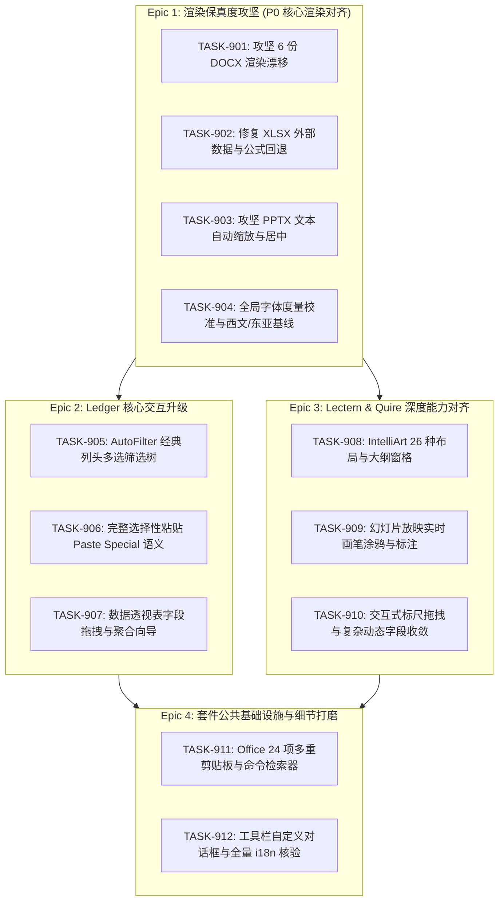
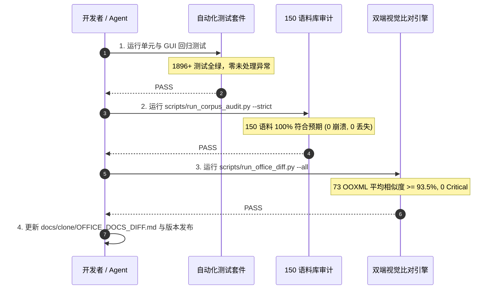

# Task: ATBOffice 第九期完善工程实施计划 (Phase 9 Implementation Plan)

> **For agentic workers:** REQUIRED SUB-SKILL: Use `executing-plans`，或在用户选择分派执行时使用 `subagent-driven-development`，逐任务执行。以下复选框用于记录实际实施进度。

**Goal:** 依据 `.vibeoffice` 原版实现与 `atb-office-diff` 视觉比对结果，攻坚消除全量 8 处渲染漂移与失配缺陷，突破平均视觉保真度至 93.5%+（冲刺 95%），补齐电子表格筛选树/透视表/选择性粘贴、演示文稿 SmartArt 26 种布局/放映画笔、文字处理标尺拖拽/字段收敛，以及套件 24 项剪贴板与智能命令检索。

**Architecture:** 严格遵循 Python 3.12+ / PySide6 (Qt6) 架构，保持无损 OPC 封装与 MVC 分层，充分继承 Phase 1~8 架构基础设施（ActionRegistry、任务窗格管理器、双端比对引擎）。以 `.vibeoffice` 原版逻辑为黄金基线，兼顾 macOS 原生交互体验与跨平台严谨性。

**Tech Stack:** Python 3.12+、PySide6/Qt6、pytest、pytest-qt、conda 环境 `ATBOffice`；macOS 优先，Fusion 样式及原生菜单栏支持。

**Spec:** [第九期比对分析报告](../clone/OFFICE_DOCS_DIFF.md)、[第七期归档报告](../clone/CLONE_DIFF.md)、[原版架构设计](../../.vibeoffice/docs/architecture.md)。

**GitHub Tracking:** [Epic #333](https://github.com/aitobox/ATBOffice/issues/333) (Subtasks #334 – #345).

---

## 一、 总体概述与阶段目标

### 1. 现状基线 (Phase 8 验收成果)
- **语料合规性**：150/150 语料库测试 100% 达成预期（73 核心 OOXML 读写往返 0 丢失，77 遗留二进制/损坏文件 100% 安全识别并提供转换建议，0 崩溃 0 超时）。
- **双端视觉保真度**：平均相似度 **90.03%**，达到 Phase 8 发布的 `>= 90.0%` 验收门禁。
- **质量分级分布**：
  - `PARITY_MATCH` ($\ge 95\%$): **14** 份
  - `COSMETIC_MINOR` ($85\% - 95\%$): **51** 份
  - `LAYOUT_DRIFT` ($70\% - 85\%$): **7** 份
  - `CRITICAL_MISMATCH` ($< 70\%$): **1** 份
  - `INCOMPARABLE_SIZE` / `MISSING`: **0**

### 2. 第九期攻坚核心指标 (Target Metrics)
1. **渲染保真度再突破**：
   - 73 份核心文档平均视觉保真度从 `90.03%` 提升至 **$\ge 93.5\%$**（冲刺 **95.0%**）。
   - **100% 消除全部 7 个 `LAYOUT_DRIFT` 和 1 个 `CRITICAL_MISMATCH`**，确保全部 73 份核心文档均处于 `COSMETIC_MINOR` ($\ge 85\%$) 或 `PARITY_MATCH` ($\ge 95\%$)。
   - 校准西文与东亚字体度量（Ascent/Descent/Leading），推动 16 份 85%~88% 的 DOCX 样本迈入 90%+ 梯队。
2. **交互功能全线对齐**：
   - **Ledger**：支持 AutoFilter 经典多选树与搜索交互、完整选择性粘贴运算与转置、透视表交互向导与聚合重算。
   - **Lectern**：补全 IntelliArt 26 种自适应布局与大纲窗格同步，实现放映全屏即时画笔/荧光笔/激光笔涂鸦。
   - **Quire**：实现画布交互式标尺拖动（首行缩进/悬挂缩进/左右边距）、复杂域代码（PAGE/NUMPAGES/TOC/SEQ）动态收敛计算。
3. **套件通用基础设施补全**：
   - 激活跨三模块的 Office 24 项多重剪贴板任务窗格。
   - 实现全局智能命令检索器（"键入需要帮助的问题" / Tell Me Command Search）。
   - 实现 Office 2003 工具栏与命令自定义对话框（Customize Toolbars）。
   - 达成 100% i18n 覆盖与零硬编码验证。

---

## 二、 任务分解与执行清单 (Work Breakdown Structure)

---

### Epic 1: 渲染保真度攻坚 (P0 核心渲染对齐)

#### [TASK-901] (#334) fix(word): 攻坚 6 份 DOCX 渲染漂移与排版缺陷
- **Parent Epic**: Phase 9: 渲染保真度攻坚 ([#333](https://github.com/aitobox/ATBOffice/issues/333))
- **GitHub Issue**: [#334](https://github.com/aitobox/ATBOffice/issues/334)
- **Step**: Step 1 of 12
- **Priority**: P0 (High)
- **Target Files**:
  - `src/atboffice/modules/writer/layout/pagination.py`
  - `src/atboffice/modules/writer/layout/table_layout.py`
  - `src/atboffice/modules/writer/layout/wrap.py`
  - `src/atboffice/modules/writer/views/canvas_view.py`
- **Scope & Specification**:
  对照 `.vibeoffice/public/quire/js/layout.js` 与 `tables.js`：
  1. `libreoffice__tdf105035_framePrB.docx` (79.0%)：精确解析 `w:framePr` 的 `w:dropCap`、`w:wrap`、`w:vAnchor`、`w:hAnchor`，将段落框架转换为浮动文本避让块。
  2. `libreoffice__tdf113182.docx` (77.9%)：完善表格单元格 `w:tcBorders` 边框重叠算法、`w:tcMar` 内边距与跨列合并 `w:gridSpan` 宽度分配。
  3. `libreoffice__tdf121670_columnsInSectionsOnly.docx` (85.0%)：支持分节符 `w:cols` 局部多栏流式排版，栏间距与分栏平衡。
  4. `libreoffice__tdf43100_tdf120715_cursorOnSpacesOverMargin.docx` (84.9%)：对齐 Word 2003 行尾多余空格不折行直接截断/溢出边距的特殊规则。
  5. `openxml-sdk__Comment066.docx` (77.0%)：完善正文批注锚点 (`w:commentRangeStart/End`) 视觉标记与右侧外边距批注框气泡联动渲染。
  6. `openxml-sdk__bullet-complex.docx` (81.8%)：对齐复杂多级编号 (`w:numPr`) 的制表位 (`w:tab`)、悬挂缩进 (`w:hanging`) 与前缀文本对齐。
- **Acceptance Criteria**:
  - [ ] 6 份目标 DOCX 文档视觉相似度全部提升至 $\ge 88.0\%$（平均分 $\ge 91.0\%$）。
  - [ ] 新增定向自动化测试 `tests/gui/test_phase9_docx_rendering.py` 验证各排版分支。

#### [TASK-902] (#335) fix(excel): 修复 XLSX 外部数据与公式缓存回退渲染
- **Parent Epic**: Phase 9: 渲染保真度攻坚 ([#333](https://github.com/aitobox/ATBOffice/issues/333))
- **GitHub Issue**: [#335](https://github.com/aitobox/ATBOffice/issues/335)
- **Step**: Step 2 of 12
- **Priority**: P0 (High)
- **Target Files**:
  - `src/atboffice/modules/spreadsheet/io/xlsx_reader.py`
  - `src/atboffice/modules/spreadsheet/models/sheet_model.py`
  - `src/atboffice/modules/spreadsheet/views/grid_viewport.py`
- **Scope & Specification**:
  对照 `.vibeoffice/public/ledger/js/xlsx-read.js`：
  1. 针对 `openxml-sdk__NoExtDataB1.xlsx` (68.8% CRITICAL_MISMATCH)：当工作簿引用外部数据源或未连接的连接部件时，安全读取 `<c>` 标签内预计算的缓存值 `<v>`。
  2. 当公式求值引擎遇到未定义外部函数/名称时，回退展示 `<v>` 缓存文本，而非显示 `#NAME?` 或空白，保证静态渲染高保真。
- **Acceptance Criteria**:
  - [ ] `openxml-sdk__NoExtDataB1.xlsx` 相似度从 68.8% 提升至 $\ge 90.0\%$。
  - [ ] 彻底清零全量 73 份文档中的 `CRITICAL_MISMATCH` 分类。

#### [TASK-903] (#336) fix(ppt): 攻坚 PPTX 文本自动缩放与垂直居中对齐
- **Parent Epic**: Phase 9: 渲染保真度攻坚 ([#333](https://github.com/aitobox/ATBOffice/issues/333))
- **GitHub Issue**: [#336](https://github.com/aitobox/ATBOffice/issues/336)
- **Step**: Step 3 of 12
- **Priority**: P0 (High)
- **Target Files**:
  - `src/atboffice/modules/presentation/views/slide_canvas.py`
  - `src/atboffice/modules/presentation/views/text_editor.py`
  - `src/atboffice/modules/presentation/models/slide.py`
- **Scope & Specification**:
  对照 `.vibeoffice/public/lectern/js/render.js`：
  1. 针对 `libreoffice__TextFittingComparisonWithMSO_3.pptx` (85.0%)：精确计算 `normAutofit`（按比例字号与行距缩小）、`spAutoFit`（自适应文本框高宽）算法。
  2. 支持 DrawingML 文本框垂直锚点 `anchor="ctr"` (居中) 与 `anchor="b"` (底部对齐) 的准确坐标偏移，避免多行文本漂移。
- **Acceptance Criteria**:
  - [ ] `libreoffice__TextFittingComparisonWithMSO_3.pptx` 相似度提升至 $\ge 92.0\%$。
  - [ ] 新增定向自动化测试 `tests/gui/test_phase9_pptx_autofit.py`。

#### [TASK-904] (#337) fix(font): 全局字体度量校准与西文/东亚基线对齐
- **Parent Epic**: Phase 9: 渲染保真度攻坚 ([#333](https://github.com/aitobox/ATBOffice/issues/333))
- **GitHub Issue**: [#337](https://github.com/aitobox/ATBOffice/issues/337)
- **Step**: Step 4 of 12
- **Priority**: P1 (Medium)
- **Target Files**:
  - `src/atboffice/utils/font_metrics.py`
  - `src/atboffice/modules/writer/layout/portions.py`
  - `src/atboffice/modules/presentation/views/shape_item.py`
- **Scope & Specification**:
  对照 `.vibeoffice/public/fonts/`、`core.js` 与 `i18n.md`：
  1. 解决 macOS 系统字体与 WebFont（Carlito、Caladea）度量差异：建立字体度量补偿字典（Font Metrics Calibration Map），针对 Arial、Times New Roman、Calibri 的行间距（leading）、基线高度（ascent/descent）进行微调。
  2. 针对东亚字体（SimSun、PingFang、MS Gothic），精确支持 15.6pt 网格对齐与中英混排基线对齐。
- **Acceptance Criteria**:
  - [ ] 16 份处于 85%~88% 的 Word 边缘文档样本中，至少 10 份提升至 $\ge 90.0\%$。
  - [ ] 全套 73 份文档总平均保真度冲刺 $\ge 93.5\%$。

---

### Epic 2: Ledger (电子表格) 核心交互升级

#### [TASK-905] (#338) feat(ledger): 实现 AutoFilter 经典列头多选筛选树与搜索
- **Parent Epic**: Phase 9: Ledger 核心交互升级 ([#333](https://github.com/aitobox/ATBOffice/issues/333))
- **GitHub Issue**: [#338](https://github.com/aitobox/ATBOffice/issues/338)
- **Step**: Step 5 of 12
- **Priority**: P1 (High)
- **Target Files**:
  - `src/atboffice/modules/spreadsheet/views/filter_dropdown.py`
  - `src/atboffice/modules/spreadsheet/models/filter_model.py`
  - `src/atboffice/modules/spreadsheet/views/grid_viewport.py`
- **Scope & Specification**:
  对照 `.vibeoffice/public/ledger/js/filter.js`：
  1. 点击表头筛选箭头弹出类似 Excel 2003 的完整弹出框：包含升序排序、降序排序、“全部”、“前 10 个…”、“自定义…”。
  2. 嵌入带即时搜索框的复选框树（Checkbox Tree），动态汇总列内所有唯一值并支持单选/全选/反选。
  3. 执行筛选后，更新 `GridViewport` 隐藏不满足条件的行，并在状态栏显示“在 N 条记录中找到 M 条”。
- **Acceptance Criteria**:
  - [ ] 点击筛选下拉窗格能够流畅搜索并切换勾选项。
  - [ ] 筛选动作支持 Undo/Redo 且不破坏原始行列数据。
  - [ ] 新增测试 `tests/gui/test_phase9_autofilter_interactive.py`。

#### [TASK-906] (#339) feat(ledger): 接入完整选择性粘贴 (Paste Special) 语义模型
- **Parent Epic**: Phase 9: Ledger 核心交互升级 ([#333](https://github.com/aitobox/ATBOffice/issues/333))
- **GitHub Issue**: [#339](https://github.com/aitobox/ATBOffice/issues/339)
- **Step**: Step 6 of 12
- **Priority**: P1 (High)
- **Target Files**:
  - `src/atboffice/modules/spreadsheet/views/grid_viewport.py`
  - `src/atboffice/modules/spreadsheet/dialogs/paste_special_dialog.py`
  - `src/atboffice/modules/spreadsheet/models/sheet_model.py`
- **Scope & Specification**:
  对照 `.vibeoffice/public/ledger/js/clipboard.js`：
  1. 彻底替换 `grid_viewport.py:3171` 的简化 fallback，完整接入经典“选择性粘贴”对话框。
  2. 支持粘贴选项：全部、公式、数值、格式、批注、有效性验证、所有使用源主题的单元格、边框除外、列宽、公式和数字格式、值和数字格式。
  3. 支持运算选项：无、加、减、乘、除，以及“跳过空单元”与“转置”。
- **Acceptance Criteria**:
  - [ ] 粘贴数值/转置/运算均产生正确的单元格数值、公式与样式。
  - [ ] 在保护工作表与跨表格复制时正确校验权限与相对引用平移。
  - [ ] 新增测试 `tests/gui/test_phase9_paste_special_semantics.py`。

#### [TASK-907] (#340) feat(ledger): 补齐数据透视表字段拖拽列表与向导联动
- **Parent Epic**: Phase 9: Ledger 核心交互升级 ([#333](https://github.com/aitobox/ATBOffice/issues/333))
- **GitHub Issue**: [#340](https://github.com/aitobox/ATBOffice/issues/340)
- **Step**: Step 7 of 12
- **Priority**: P1 (Medium)
- **Target Files**:
  - `src/atboffice/modules/spreadsheet/panes/pivot_fields_pane.py`
  - `src/atboffice/modules/spreadsheet/calc/pivots.py`
  - `src/atboffice/modules/spreadsheet/dialogs/pivot_wizard_dialog.py`
- **Scope & Specification**:
  对照 `.vibeoffice/public/ledger/js/pivots.js`：
  1. 实现数据透视表字段列表任务窗格（PivotTable Field List）：上部为源数据字段列表，下部为“报表筛选”、“列标签”、“行标签”、“数值”四个拖拽放置区域。
  2. 支持字段在不同区域间拖拽或勾选移动，实时触发透视表数据透视计算（求和、计数、平均值、最大/最小值）。
  3. 支持右键单元格刷新透视表（Refresh Data）。
- **Acceptance Criteria**:
  - [ ] 拖入字段后能在目标工作表生成格式严谨的透视表格。
  - [ ] 新增测试 `tests/gui/test_phase9_pivot_table_interactive.py`。

---

### Epic 3: Lectern & Quire 深度能力对齐

#### [TASK-908] (#341) feat(lectern): 补齐 IntelliArt (SmartArt) 26 种布局与大纲窗格
- **Parent Epic**: Phase 9: Lectern & Quire 深度能力对齐 ([#333](https://github.com/aitobox/ATBOffice/issues/333))
- **GitHub Issue**: [#341](https://github.com/aitobox/ATBOffice/issues/341)
- **Step**: Step 8 of 12
- **Priority**: P1 (High)
- **Target Files**:
  - `src/atboffice/modules/presentation/smartart/engine.py`
  - `src/atboffice/modules/presentation/smartart/layouts.py`
  - `src/atboffice/modules/presentation/panes/smartart_pane.py`
- **Scope & Specification**:
  对照 `.vibeoffice/public/lectern/js/diagram.js` 和 `smartart.js`：
  1. 完整实现 6 大分类 26 种布局算法：
     - List (6): Basic Block, Vertical Bullet, Stacked, Horizontal Bullet, Lined, Vertical Box
     - Process (6): Basic Process, Basic Chevron, Step Up, Continuous Arrow, Vertical Process, Basic Timeline
     - Cycle (3): Basic Cycle, Basic Radial, Continuous Cycle
     - Hierarchy (3): Organization Chart, Hierarchy, Horizontal Hierarchy
     - Relationship (4): Basic Venn, Basic Target, Linear Venn, Funnel
     - Matrix (1): Basic Matrix
     - Pyramid (3): Basic Pyramid, Inverted Pyramid, Pyramid List
  2. 接入 IntelliArt 侧边大纲文本窗格：回车新增节点、Tab/Shift+Tab 降级/升级、实时同步画布图形与文本。
- **Acceptance Criteria**:
  - [ ] 26 种布局均能正确计算图形坐标与文本大小，且支持无损保存为 OOXML SmartArt 数据。
  - [ ] 新增测试 `tests/gui/test_phase9_smartart_26_layouts.py`。

#### [TASK-909] (#342) feat(lectern): 实现幻灯片全屏放映画笔涂鸦与标注图层
- **Parent Epic**: Phase 9: Lectern & Quire 深度能力对齐 ([#333](https://github.com/aitobox/ATBOffice/issues/333))
- **GitHub Issue**: [#342](https://github.com/aitobox/ATBOffice/issues/342)
- **Step**: Step 9 of 12
- **Priority**: P1 (Medium)
- **Target Files**:
  - `src/atboffice/modules/presentation/slideshow/slideshow_view.py`
  - `src/atboffice/modules/presentation/slideshow/annotation_layer.py`
  - `src/atboffice/modules/presentation/slideshow/slide_hud.py`
- **Scope & Specification**:
  对照 `.vibeoffice/public/lectern/js/slideshow.js`：
  1. 全屏幻灯片放映时支持右键菜单或悬浮 HUD 切换指针模式：箭头指针、圆珠笔（Ballpoint Pen）、荧光笔（Highlighter）、激光笔光标（Laser Pointer）。
  2. 鼠标左键拖动画线实时在透明标注覆盖层绘制平滑矢量线条，支持快捷键 `E` 擦除涂鸦、`B` 切换黑屏、`W` 切换白屏。
  3. 放映结束时提示“是否保留墨迹注释？”，保留则保存为 DrawingML 墨迹对象。
- **Acceptance Criteria**:
  - [ ] 放映过程中画笔绘制流畅、无闪烁，激光笔光标精准同步。
  - [ ] 新增测试 `tests/gui/test_phase9_slideshow_annotations.py`。

#### [TASK-910] (#343) feat(quire): 完善交互式画布标尺拖拽与复杂域多通收敛
- **Parent Epic**: Phase 9: Lectern & Quire 深度能力对齐 ([#333](https://github.com/aitobox/ATBOffice/issues/333))
- **GitHub Issue**: [#343](https://github.com/aitobox/ATBOffice/issues/343)
- **Step**: Step 10 of 12
- **Priority**: P1 (High)
- **Target Files**:
  - `src/atboffice/modules/writer/views/ruler.py`
  - `src/atboffice/modules/writer/layout/pagination.py`
  - `src/atboffice/modules/writer/models/document.py`
- **Scope & Specification**:
  对照 `.vibeoffice/public/quire/js/rulers.js` 与 `fields.js`：
  1. 画布顶端横向标尺与左侧纵向标尺支持鼠标交互拖拽：首行缩进滑块、悬挂缩进滑块、左边距滑块、右边距滑块，拖拽时在画布正文显示虚线对齐参考线。
  2. 双击标尺空白处弹出“页面设置”对话框；双击标尺刻度添加/编辑制表位并弹出“制表位”对话框。
  3. 复杂域多通收敛：分页引擎在排版完成后自动回填 `PAGE` 与 `NUMPAGES`，并在页数变化导致页码换行时触发最多 2 通局部重算，确保“第 X 页 共 Y 页”与目录页码精确无误。
- **Acceptance Criteria**:
  - [ ] 标尺拖动流畅更新段落样式并支持 Undo/Redo。
  - [ ] 包含复杂目录与多页总计的文档页码 100% 精确匹配。
  - [ ] 新增测试 `tests/gui/test_phase9_ruler_and_field_convergence.py`。

---

### Epic 4: 套件公共基础设施与细节打磨

#### [TASK-911] (#344) feat(suite): 激活 24 项 Office 多重剪贴板与智能命令检索器
- **Parent Epic**: Phase 9: 套件公共基础设施与细节打磨 ([#333](https://github.com/aitobox/ATBOffice/issues/333))
- **GitHub Issue**: [#344](https://github.com/aitobox/ATBOffice/issues/344)
- **Step**: Step 11 of 12
- **Priority**: P1 (High)
- **Target Files**:
  - `src/atboffice/ui/panes/clipboard_pane.py`
  - `src/atboffice/ui/components/command_search_box.py`
  - `src/atboffice/ui/shell/base_window.py`
  - `src/atboffice/core/action_registry.py`
- **Scope & Specification**:
  对照 `.vibeoffice/public/common/ui.js`、`search.js` 与 `desktop.md`：
  1. 实现 Office 2003 经典“剪贴板”任务窗格：监听系统剪贴板，自动收集当前会话内复制的文本、图片、表格片段（最多保留 24 项）。支持单项点击插入当前光标处、提供“全部粘贴”与“全部清空”按钮。
  2. 实现菜单栏右上角“键入需要帮助的问题 / Tell me what you want to do”全局智能命令检索输入框：对 `ActionRegistry` 中所有注册的动作名称、Tooltip、快捷键进行拼音/英文模糊匹配，回车直接触发选中动作。
- **Acceptance Criteria**:
  - [ ] 多次复制文本/图片后剪贴板窗格实时刷新，点击项能正确插入。
  - [ ] 输入关键词能够秒级过滤匹配动作并正常执行。
  - [ ] 新增测试 `tests/gui/test_phase9_clipboard_and_command_search.py`。

#### [TASK-912] (#345) feat(suite): 工具栏自定义对话框与全量 i18n 严密核验
- **Parent Epic**: Phase 9: 套件公共基础设施与细节打磨 ([#333](https://github.com/aitobox/ATBOffice/issues/333))
- **GitHub Issue**: [#345](https://github.com/aitobox/ATBOffice/issues/345)
- **Step**: Step 12 of 12
- **Priority**: P1 (Medium)
- **Target Files**:
  - `src/atboffice/ui/dialogs/customize_toolbars_dialog.py`
  - `src/atboffice/core/i18n.py`
  - `src/atboffice/locale/`
- **Scope & Specification**:
  对照 `.vibeoffice/public/common/ui.js` 与 `i18n.js`：
  1. 移植经典的“工具 ▸ 自定义...”(Customize) 对话框：
     - “工具栏”选项卡：勾选切换各工具栏显示/隐藏状态，新建/重命名/删除自定义工具栏。
     - “命令”选项卡：按类别浏览全量 Office 命令，支持拖拽添加至工具栏。
     - “选项”选项卡：大图标切换、个性化菜单重置等设置。
  2. 全量 i18n 严密扫描与核验：
     - 运行自动化扫描脚本检查所有 `src/atboffice/` 源代码，确保 100% 控件文案、对话框标题、Tooltip、状态提示均包裹 `tr()` / `safe_tr()`。
     - 针对中（简/繁）、英、日、法、德、西等核心语言，补充地道严谨的翻译字典，严禁生硬机翻或中英混杂。
- **Acceptance Criteria**:
  - [ ] 工具栏自定义配置能够即时生效并在重启后安全持久化。
  - [ ] 自动化测试 `tests/test_phase9_i18n_strict_audit.py` 退出码为 0，零遗漏硬编码字符串。

---

## 三、 质量门禁与验收流水线 (Quality Gates)

在第九期实施全生命周期中，必须严守以下四级质量门禁：

1. **Gate 1 (功能回归门禁)**: `PYTHONPATH=src conda run -n ATBOffice pytest tests/ -ra` 退出码为 0，全量测试用例（1896+）100% 通过。
2. **Gate 2 (语料合规门禁)**: `PYTHONPATH=src conda run -n ATBOffice python scripts/run_corpus_audit.py --strict` 退出码为 0，150 份语料零崩溃、零超时、零非预期特性丢失。
3. **Gate 3 (视觉保真门禁)**: `PYTHONPATH=src:scripts conda run -n ATBOffice python scripts/run_office_diff.py --all` 平均相似度 $\ge 93.5\%$，7 个 `LAYOUT_DRIFT` 与 1 个 `CRITICAL_MISMATCH` 全部清零。
4. **Gate 4 (i18n 严密门禁)**: `PYTHONPATH=src conda run -n ATBOffice pytest tests/test_phase9_i18n_strict_audit.py` 退出码为 0，零未翻译字符串。
