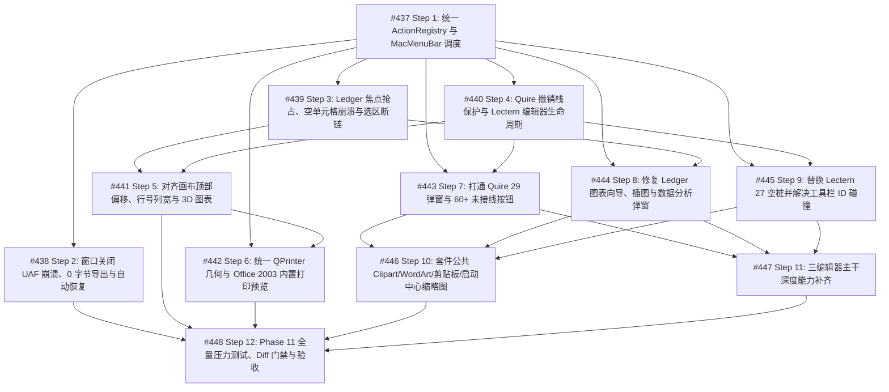

# Task: ATBOffice 第十一期稳定性加固、打印预览重构与全端对齐实施计划 (Phase 11 Implementation Plan)

> **GitHub Tracking**: [Epic #436](https://github.com/aitobox/ATBOffice/issues/436) (`epic:phase11`, Subtasks [#437](https://github.com/aitobox/ATBOffice/issues/437) – [#448](https://github.com/aitobox/ATBOffice/issues/448))  
> **Spec & Evidence**: [综合对比与稳定性审计报告](../clone/ATBOFFICE_PARITY_AND_STABILITY_AUDIT_2026_11.md)、[双端视觉比对报告](../clone/OFFICE_DOCS_DIFF.md)、[原版架构文档](../../.vibeoffice/docs/suite.md)

---

## 一、 阶段目标与质量基线

### 1.1 现状基线（2026-11-21 实测）
- **运行期崩溃日志（`~/.atboffice/logs/crash.log`）**：存在 7 次 C++ `Segmentation fault`（窗口关闭重入、打印预览双连重入、网格鼠标移动）及 45+ 次高频未捕获 Python 异常（`SpreadsheetObjectLayer` `QKeyEvent.StandardKey`、空白单元格格式刷/格式化 `NoneType` 崩溃）。
- **双端视觉比对（`atb-office-diff`）**：73 份核心 OOXML 像素 MAE 均值 `96.91%`，但**前景加权相似度均值仅 `65.31%`**（`22 PARITY_MATCH`、`2 COSMETIC_MINOR`、`19 LAYOUT_DRIFT`、`30 CRITICAL_MISMATCH`）。
- **UI 接线与打印预览**：110+ 工具栏/菜单动作落入 `"正在联调中"`，Quire 29 个弹窗丢弃结果，Lectern 27 个方法为空桩且 `Save As` 覆盖原文件，三端打印预览未配置 `QPrinter` 全页/纸张/方向且存在绘制缺漏。

### 1.2 第十一期核心验收门禁
1. **P0 零崩溃门禁**：长程压力回放与日常编辑（`.docx`/`.xlsx`/`.pptx`）零未处理异常、零 C++ `SIGSEGV`，无 0 字节导出文件，加密保存不丢失密码。
2. **打印预览保真门禁**：三端输出均按文档物理尺寸与方向设置 `QPrinter`（`setFullPage(True)`），无偏移裁切；支持窗口内多页/缩放/讲义/备注/页面设置预览。
3. **UI 零断链门禁**：`MacMenuBar` 与 `ActionRegistry` 单次派发零重入，0 个无意孤立控件，已接线控件 0 处弹出 `"正在联调中"`。
4. **视觉保真门禁**：`scripts/run_office_diff.py --all --capture --strict` 73 份文档前景加权平均相似度 `>= 90.0%`，`CRITICAL_MISMATCH` 清零。

---

## 二、 拓扑依赖图 (Execution DAG)

---

## 三、 子任务清单与验收矩阵

| Step | Issue | 类型 | 优先级 | 依赖 | 核心交付范围 |
|---:|---|---|---|---|---|
| 1 | [#437](https://github.com/aitobox/ATBOffice/issues/437) | `bug` | `priority:high` | None | 消除 `MacMenuBar` 双连/三连触发、修复 `alias` 规范注册与跨模块重复菜单项、修复 `StartCenter` 动作与 `_show_getting_started_pane` |
| 2 | [#438](https://github.com/aitobox/ATBOffice/issues/438) | `bug` | `priority:high` | `#437` | 移除 `closeEvent` 内 `drain_event_loop`、消除 0 字节文件保存落空、启动 `RecoveryService` 并保留加密密码 |
| 3 | [#439](https://github.com/aitobox/ATBOffice/issues/439) | `bug` | `priority:high` | `#437` | 修复 `SpreadsheetObjectLayer` `QKeySequence.StandardKey` 与焦点抢占、18 处空单元格 `None` 崩溃、切表/开文件选区信号断链、`GridViewport.mouseMoveEvent` 加固 |
| 4 | [#440](https://github.com/aitobox/ATBOffice/issues/440) | `bug` | `priority:high` | `#437` | 修复 `WriterCanvasView._on_formatting_applied` 清空撤销栈与光标复位、缓解每键全量重排卡顿、加固 Lectern 编辑器与 `SlideScene` 生命周期及大纲正文保存 |
| 5 | [#441](https://github.com/aitobox/ATBOffice/issues/441) | `bug` | `priority:high` | `#439`, `#440` | 对齐 Quire 画布顶部留白与 Ledger 行号列宽、实现 3D 柱状图与 SmartArt 对齐、推动 73 份文档前景相似度 `>= 90.0%` |
| 6 | [#442](https://github.com/aitobox/ATBOffice/issues/442) | `feature` | `priority:high` | `#437`, `#441` | 统一配置 `QPrinter` 纸张/方向/`setFullPage(True)`、修复 Quire 打印丢失编号/边框/高亮、接入 Ledger 页面设置与图表绘制、补全 Lectern 讲义/备注/大纲/灰度与窗口内预览 |
| 7 | [#443](https://github.com/aitobox/ATBOffice/issues/443) | `bug` | `priority:high` | `#437`, `#440` | 写回 Quire 29 个弹窗配置、绑定 `format_*`/页眉页脚/图片/审阅/大纲工具栏与孤立下拉框、修复 Highlight `"none"` 与双连覆盖 bug |
| 8 | [#444](https://github.com/aitobox/ATBOffice/issues/444) | `bug` | `priority:high` | `#437`, `#439` | 修复 Ledger `ChartWizardDialog` 数据源绑定与新表图表、`insert_picture` 读取图片字节、`Subtotal`/`Consolidate`/`AdvancedFilter`/`DataTable` 实际计算及菜单补全 |
| 9 | [#445](https://github.com/aitobox/ATBOffice/issues/445) | `bug` | `priority:high` | `#437`, `#440` | 修复 Lectern `save_as_dialog` 覆盖原文件、真实插图/插图表、表单元格编辑与重绘、拆分 `alignLeft` 碰撞、替换 27 个状态栏空桩 |
| 10 | [#446](https://github.com/aitobox/ATBOffice/issues/446) | `feature` | `priority:medium` | `#443`, `#444`, `#445` | 打通通用 Clipart/WordArt 插入、多重剪贴板图片粘贴、Undo/Redo 动态历史下拉菜单、Start Center 缩略图/22 模板/崩溃恢复面板、Scout 零空闲 CPU |
| 11 | [#447](https://github.com/aitobox/ATBOffice/issues/447) | `feature` | `priority:medium` | `#443`, `#444`, `#445` | 补全 Quire 视图模式/画布页眉页脚与浮动图拖拽/正文修订样式、Ledger 动态数组溢出/`Table1[Col]`/大纲分组/可拖拽分页符、Lectern 动效预览与音视频/排练计时 |
| 12 | [#448](https://github.com/aitobox/ATBOffice/issues/448) | `enhancement` | `priority:high` | `#438`, `#441`, `#442`, `#446`, `#447` | Phase 11 全量回归、长程操作稳定性压力测试、150 语料审计、73 文档视觉门禁与发布签核 |

---

## 验收结果（#448，2026-11-22，基线提交 `b205424`）

- 子任务 #437 – #447 均已合并入 main；#448 完成全量回归、长程压力测试与发布签核。
- 视觉 Diff：73/73 可比，前景加权平均 **93.79%**（门禁 ≥ 90%），**0 CRITICAL_MISMATCH**；3 份 LAYOUT_DRIFT 由字体回退与幻灯片尺寸缩放导致，作为后续打磨项。
- 语料审计：154 份 0 崩溃 / 0 超时 / 0 失败 / 0 数据丢失。
- 控件审计：0 ORPHAN_NO_SIGNAL、0 空桩、0 "正在联调中"兜底、0 重复触发。
- 详见 [ATBOFFICE_PARITY_AND_STABILITY_AUDIT_2026_11.md](../clone/ATBOFFICE_PARITY_AND_STABILITY_AUDIT_2026_11.md) 第八节与 [OFFICE_DOCS_DIFF.md](../clone/OFFICE_DOCS_DIFF.md)。
