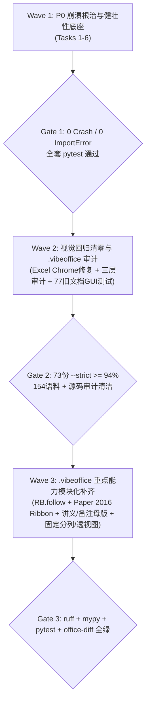

# Task: ATBOffice 第十二期健壮性加固、渲染回归修复与 `.vibeoffice` 全量对齐实施计划 (Phase 12 Roadmap)

> **设计规格**：[2026-11-26-phase12-robustness-and-parity-design.md](file:///Users/aitobox/work/aitobox/ATBOffice/docs/superpowers/specs/2026-11-26-phase12-robustness-and-parity-design.md)  
> **Wave 1 详细实施计划**：[2026-11-26-phase12-wave1-robustness.md](file:///Users/aitobox/work/aitobox/ATBOffice/docs/superpowers/plans/2026-11-26-phase12-wave1-robustness.md)  
> **Wave 3 详细实施计划**：[2026-11-26-phase12-wave3-feature-parity.md](file:///Users/aitobox/work/aitobox/ATBOffice/docs/superpowers/plans/2026-11-26-phase12-wave3-feature-parity.md)  
> **代码基线**：`v0.2.0`（`ecac6b3`） vs. `.vibeoffice/`

---

## 一、 现状基线与核心目标

- **崩溃与断链基线**：定位到 4 处生产懒加载 `ImportError`（`ledger_auditing.py` `to_a1`、`writer/view.py` `add_comment`、`fn_dynamic.py` `parse_cell_reference`）、Quire 缺失 `WriterCanvasView.insert_shape`、编号文档键入触发全量导入卡顿、`lectern_history.py` 无主对象校验 `QTimer.singleShot`，以及缺少统一的 Qt 故障隔离与 `shiboken6.isValid()` 守卫。
- **视觉比对基线**：`run_office_diff.py --all --capture --strict` 73/73 可比，前景均值从 `93.79%` 回落到 `92.71%`，Excel 24 份因 Phase 3 Luna 滚动条/标签栏变更掉分 5%–10%（`poi__45540_form_Header.xlsx` `81.8%`、`poi__49156.xlsx` `84.5%`），且 `--strict` 尚未豁免 `reference_limitation` 文档。
- **对比与能力缺口**：154 份语料审计通过、`source_diff.py --check` 0 孤儿/0 空桩，`audit_toolbars_parity.py` 存在个别提示文案错配；`.vibeoffice` 重点差距锁定为上下文任务窗格自动跟随（`RB.follow`）、Paper 2016 Ribbon、Lectern 讲义/备注母版、Ledger 条件格式闭环核验 + 固定宽度分列 & 透视图。

---

## 二、 三波次门禁拓扑 (Execution DAG)

---

## 三、 Wave 1 实施任务表（已细化至可逐条执行）

详细 TDD 步骤、精确代码与验收命令见 [2026-11-26-phase12-wave1-robustness.md](file:///Users/aitobox/work/aitobox/ATBOffice/docs/superpowers/plans/2026-11-26-phase12-wave1-robustness.md)。

| Task | 目标范围 | 核心产出 | 状态 |
|---:|---|---|---|
| 1 | 修复 4 处懒加载 `ImportError` 并建立 AST 审计门禁 | `tests/test_lazy_imports_integrity.py` + `ledger_auditing.py` / `writer/view.py` / `fn_dynamic.py` | done |
| 2 | 统一 Qt 故障隔离与 `shiboken6.isValid()` 守卫层 | `src/atboffice/core/fault_guard.py` + `base_window.py` 定时器回收 + `test_fault_guard.py` | done |
| 3 | Quire `insert_shape`、浮动对象操作与编号键入卡顿根治 | `styles.py` 缓存导入 + `canvas_editing.py` + `canvas_input.py` + 回归测试 | done |
| 4 | Ledger 对象层撤销、批注撤销与 `object_layer` 守卫 | `ledger_objects.py` + `ledger_auditing.py` + `object_layer.py` + 回归测试 | done |
| 5 | Lectern `PresentationHistory` 定时器回收与 `SlideScene` 守卫 | `lectern_history.py` + `lectern_window.py` + `slide_canvas.py` + 回归测试 | done |
| 6 | 三端「开文件→插元素→编辑→撤销→保存重开」总压测门禁 | `tests/gui/test_phase12_element_edit_robustness.py` + 全量 CI 验证 | done |

---

## 四、 Wave 2 与 Wave 3 里程碑（随前置门禁通过后展开细化计划）

> 为遵循门禁隔离与零占位符要求，Wave 2 与 Wave 3 的逐行 TDD 实施计划将在各自前置 Gate 通过后立刻编写；范围与接口合同已冻结在设计规格中：

- **Wave 2 — 渲染回归清零与 `.vibeoffice` 全面对比审计（done — 73 份 `--strict` 均值 `95.37%`，0 低于阈值）**：
  1. 已修复 Luna 样式下 Ledger 滚动条与 `SheetTabBar` 像素偏移，Excel 24 份前景均值恢复至 `96.86%`（`libreoffice__empty.xlsx` `98.9%`、`poi__45540_form_Header.xlsx` `97.9%`、`poi__49156.xlsx` `95.1%`、`libreoffice__totalsRowFunction.xlsx` `87.0%`）；
  2. 已统一 `scripts/run_office_diff.py` `evaluate_strict_gate()` 与 `reporter.py` 对 `reference_limitation` 的单文档豁免口径；
  3. 已修正 Quire `insertComment` 跨端提示文案错配，补充 `tests/gui/test_phase12_corpus_gui_resilience.py` 验证 77 份旧格式/加密/损坏语料 GUI 错误弹窗与脏文档状态回滚保护；
  4. 已更新 [OFFICE_DOCS_DIFF.md](file:///Users/aitobox/work/aitobox/ATBOffice/docs/clone/OFFICE_DOCS_DIFF.md)、[TOOLBAR_BASELINE_MATRIX.md](file:///Users/aitobox/work/aitobox/ATBOffice/docs/clone/TOOLBAR_BASELINE_MATRIX.md) 与 [ATBOFFICE_PARITY_AND_STABILITY_AUDIT_2026_12.md](file:///Users/aitobox/work/aitobox/ATBOffice/docs/clone/ATBOFFICE_PARITY_AND_STABILITY_AUDIT_2026_12.md)。
- **Wave 3 — `.vibeoffice` 四项重点能力模块化补齐**：
  1. `context_tools_pane.py` + `BaseOfficeWindow` 上下文任务窗格自动跟随（`view/pane_follows_selection`）；
  2. `ribbon_bar.py` + 三端声明式 `*_ribbon.py` 懒构建 Paper 2016 Ribbon 模式与契约测试；
  3. `master_view.py` 扩展 Lectern 讲义母版与备注母版编辑、打印与 PPTX 往返；
  4. Ledger 色阶/数据条/图标集闭环测试、`TextToColumnsWizardDialog` 固定宽度标尺分列、以及透视表关联 PivotChart。
